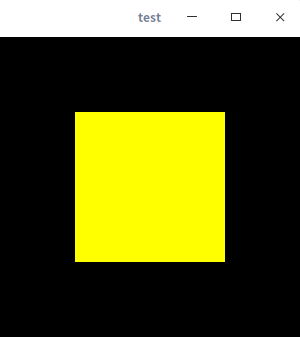
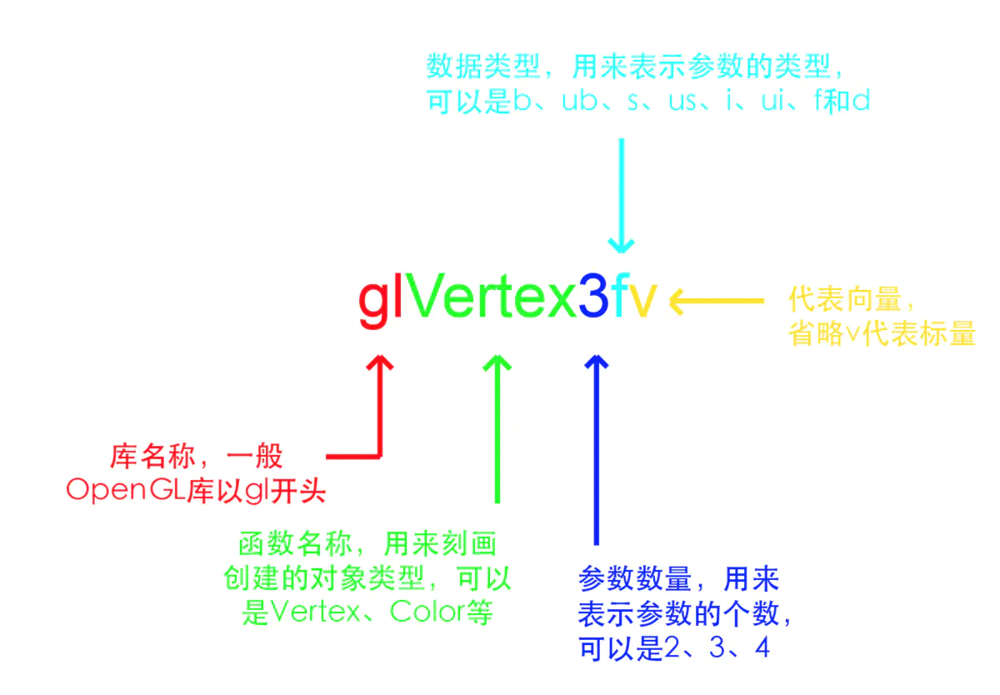
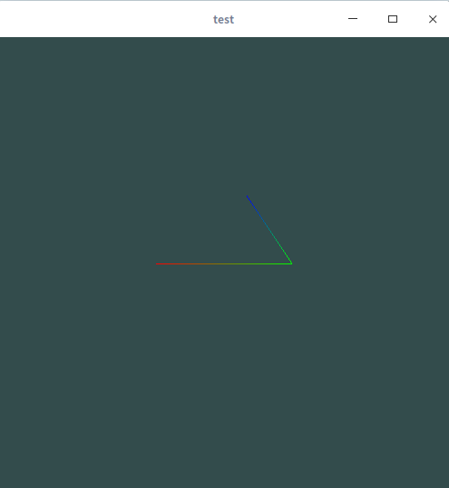
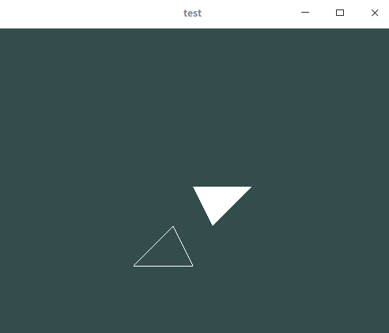
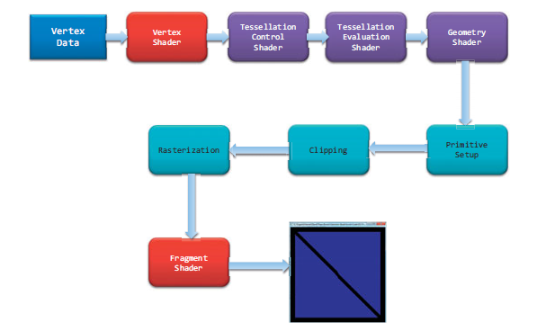
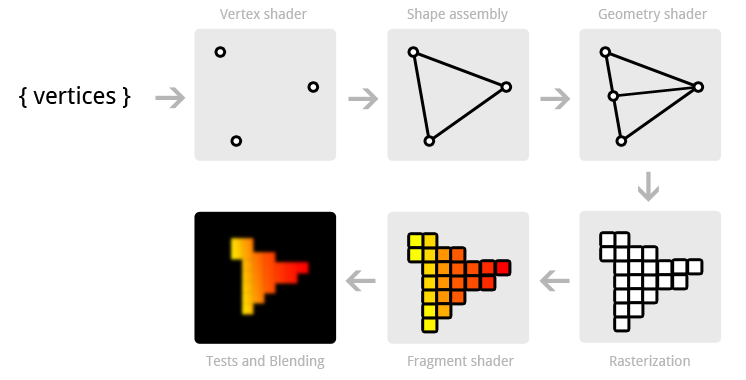

[TOC]
#  概述

## OpenGL

OpenGL是渲染2D、3D矢量图形硬件的一种软件接口。本质上说，它是一个3D图形和模型库，具有高度的可移植性，并且具有非常快的渲染速度。OpenGL并不是一种语言，而是更像一个C运行时函数库。它提供了一些预包装的功能，帮助开发人员编写功能强大的三维应用程序。 OpenGL可以再多种操作系统平台上运行，例如各种版本的Windows、UNIX/Linux、Mac OS 和 OS/2等。如今，OpenGL广泛流行于游戏、医学影像、地理信息、气象模拟等领域，是高性能图像和交互性场景处理的工业标准。
OpenGL的高效实现（利用了图形加速硬件）存在于Windows，部分UNIX平台和Mac OS。这些实现一般由显示设备厂商提供，而且非常依赖于该厂商提供的硬件。


## OpenGL的理解

OpenGL本质上是一个渲染图形的API。它是跨平台、跨语言的，并且非常底层可以和GPU直接交流。目前，OpenGL有四个大版本分为两种编程方式—— **固定渲染管线** 和 **可编程渲染管线** 编程方式。同时，OpenGL又是一个规范，它由Khronos组织维护，具体实现则是由各个GPU生产商实现的。

> 早期OpenGL就是 **固定渲染管线** 的编程方式的，OpenGL1.0到4.0都支持。它主要以图元的方式渲染制图，这与微软MFC的GDI很相似，就是通过调用不同的函数画不同的图形。而与之对应的现代OpenGL是 **可编程渲染管线** 的编程方式，它更接近底层的GPU渲染，用户操作起来更自由但是更难上手。

## OpenGL相关库

- GLUT/GLFW

GLUT就是OpenGL的具体API。由于OpenGL过于底层，我们不能对其直接操作，所以我们要借助GLUT中的函数来实现我们想要的具体功能。但是GLUT本身并不是很完善，只能做一些简单的，小规模的程序。而GLFW是GLUT的进化版，虽然实现的功能差不多，但是它更完善与OpenGL4.0更贴切。

- GLEW

GLEW是OpenGL的扩展库，它是基于C/C++开发的。当我们需要最新的OpenGL功能时就需要调用这个库内的函数实现。此外，它还包括WGL、GLX的扩展功能。

- GLM

GLM是OpenGL的数学库，是用来做图形的变换的（例如旋转、平移和斜切等）。很多时候它就是一个头文件，只要在项目中加载就可以了。

- GLSL

GLSL是一种对着色器操作的语言，有点类似C语言，它包含一些针对向量和矩阵操作的有用特性。这在现代OpenGL中经常用到。


# 软件安装

在正式开始学习OpenGL之前，我们需要先配置好OpenGL的软件环境。

# 开发环境

建议用Linux开发。环境配置十分简单。这里先使用GLUT库初步了解一下OpenGL，之后可以使用GLFW等较新的库。

```shell
sudo apt-get install build-essential
sudo apt-get install libgl1-mesa-dev
sudo apt-get install libglu1-mesa-dev
sudo apt install freeglut3-dev
```

# 测试OpenGL环境

我们添加一个简单的绘制矩形的OpenGL代码：

```cpp
#include <iostream>
#include <GL/gl.h>
#include <GL/glut.h>
void display()
{
    glClear(GL_COLOR_BUFFER_BIT);
    glColor3f(1.f,1.f,0.f);
    glBegin(GL_POLYGON);
    glVertex2f(-0.5, -0.5);
    glVertex2f(-0.5, 0.5);
    glVertex2f(0.5, 0.5);
    glVertex2f(0.5, -0.5);
    glEnd();
    glFlush();
}
int main(int argc, char ** argv)
{
    glutInit(&argc, argv);
    glutCreateWindow("test");
    glutDisplayFunc(display);
    glutMainLoop();
}
```

运行起来，如果能产生下图效果则说明你的环境搭建成功了。




# OpenGL基本用法

## 引入头文件

在早期OpenGL中必须引入这两个库`<GL/gl.h>`和`<GL/glut.h>`。这两个头文件分别对应了之前提到的两个框架，我们运用到的大部分函数都是这个库里面的。

## 初始化GLUT

```c++
glutInit(&argc, argv);
```

这个函数传了主函数的两个参数，它除了初始化GLUT库以外还会与窗口系统沟通。如果操作系统没有合适的OpenGL或者非法命令行选项就会抛出错误，初始化失败。

## 创建窗口

```c++
glutCreateWindow("test");
```

这个函数被用来创建一个显示图像的窗口。它有一个字符指针类型的参数，用来初始化窗口显示的名称，还有一个整数类型的返回值，用来标识该创建的窗口。需要注意的是，所有新建的窗口都是有单独的OpenGL上下文，也就是说有各自的 **状态机**，因此窗口标识符可以用来区别这些窗口。

> OpenGL的**状态机**就是当前状态变量及其值构成的集合和其他系统状态。OpenGL的状态由函数驱动，调用不同的函数可以改变OpenGL的状态

## 渲染图形

```c++
glutDisplayFunc(display);
```

这个函数表现形式很简单，但意义不简单。只有一个参数，用来传一个渲染图形的回调函数，没有返回值。和前面函数不同的是，GLUT会根据状态机中的重显（redisplay）状态来决定是否渲染。当它需要重显时，渲染图形的回调函数就会被调用，同时被渲染的层（layer）又会被设置成正常平面（normal plane）。而这个重显状态可以通过隐式和显式两种方式转换，其中一种隐式转换就是通过前面调用`glutCreateWindow("test")`函数来转换。显式则是调用`glutPostRedisplay()`函数进行重新渲染

## 进入事件处理循环

图形被渲染之后不能让它马上结束程序，因此我们通过加入事件处理循环来组织窗口的关闭。

```c++
glutMainLoop();
```

这个函数既没有参数，也没有返回值。只是单纯的进入事件处理循环使得GLUT不断的调用渲染图形回调函数。通过这种办法我们就可以在显示器看到图形了。

## 其他GLUT函数

- `void glutInitDisplayMode(unsigned int mode)`

这个函数用来初始化显示方式，通过传入一个无符号整数类型来控制用哪个方式显示。可以传入的参数有`GLUT_RGBA`、`GLUT_INDEX`、`GLUT_SINGLE`和`GLUT_DOUBLE`等。它们可以设置颜色属性、缓冲存储等。

-  `void glutInitWindowSize(int width, int height)`和`void glutInitWindowPosition(int x, int y)` 

这两个函数都是对窗口属性设置的函数，分别是设置窗口的大小以及窗口的位置，单位是像素。当然不是一定要设置这些属性，默认窗口大小是300px*300px，位置在原点（左上角）。

- `void glutPostRedisplay(void)`

这个函数就是前面所说的显示转换重显状态的函数，也可以说是调用当前窗口的正常平面的渲染图形回调函数。

- `void glutReshapeFunc(void (*func)(int width, int height))`

这个函数是为当前窗口注册渲染图形回调函数的。和之前不同的是它只是注册一个回调函数，而这个函数是在窗口需要被重绘（reshape）或者新的层覆盖了窗口时被调用。此外，还有一系列以glut开头并以Func结尾的函数，例如`glutKeyboardFunc(void (*func)(unsigned char key, int x, int y))`、`glutMouseFunc(void (*func)(int button, int state, int x, int y))`和`glutMotionFunc(void (*func)(int x, int y))`等。我们称之为事件处理函数，它们分别响应特殊的事件来调用相应的回调函数来处理。

> 关于GLUT就解释到这里，还有很多函数可以参考[官方文档](https://link.jianshu.com?t=https%3A%2F%2Fwww.opengl.org%2Fresources%2Flibraries%2Fglut%2Fspec3%2Fspec3.html)。

## 渲染回调函数

```
void display()
{
    glClear(GL_COLOR_BUFFER_BIT);
    glBegin(GL_POLYGON);
    glVertex2f(-0.5, -0.5);
    glVertex2f(-0.5, 0.5);
    glVertex2f(0.5, 0.5);
    glVertex2f(0.5, -0.5);
    glEnd();
    glFlush();
}
```

这是测试代码的渲染图形回调函数，我们能看到显示的图形就是由这个函数刻画的。

### 将缓冲清除到预设的值

这几乎是所有OpenGL制图的第一步，因为你画图时总希望窗口是干净的。除非你每次都想在上一次重显后继续进行，然而这并不常见。调用`void glClear(GLbitfield mask)`函数可以清除缓冲，这个函数传一个标识位来控制应该清除哪一种缓冲。目前有三种可选的标识位`GL_COLOR_BUFFER_BIT`、`GL_DEPTH_BUFFER_BIT`和`GL_STENCIL_BUFFER_BIT`，我们只用到清除颜色缓冲到预设值，也就是说每次重显都要将窗口变成预设颜色。

那么怎么确定预设值呢？OpenGL提供了一系列的函数来刻画预设值`void glClearColor(GLfloat red,GLfloat green,GLfloat blue,GLfloat alpha)`、`void glClearDepth(GLdouble depth)`和`void glClearStencil(GLint s)`分别对应上述的缓冲。拿颜色缓冲举例，我们在传入的参数中确定了颜色信息（RGBA）就可以将每次重显的颜色确定好。

### 界定渲染顶点

早期的OpenGL通过`void glBegin(GLenum mode)`和`void glEnd(void)`一对函数来确定一个或一组图元（primitive）的顶点。所有的图元顶点声明都放在这一对函数之间，图元的类型由`void glBegin(GLenum mode)`函数的参数传入。这个参数是一个枚举类型，可以是`GL_POINTS`、`GL_LINES`、`GL_LINE_STRIP`、`GL_LINE_LOOP`、`GL_TRIANGLES`、`GL_TRIANGLE_STRIP`、`GL_TRIANGLE_FAN`、`GL_QUADS`、`GL_QUAD_STRIP`和`GL_POLYGON`中的任意类型。

### 刻画顶点



OpenGL函数

这是给出的OpenGL的函数公式，绝大多数OpenGL的函数都是这样定义的。所以对照这个公式，我们就可以理解测试代码中利用`glVertex2f(-0.5, -0.5)`等函数定义了一系列点坐标。需要注意的是OpenGL的坐标范围都是从-1.0f到+1.0f，颜色范围在0.f到1.f之间。

## 点、线、面

### 点

绘图的基础是图元，而图元的基础就是一个一个的像素点。首先介绍一下点的画法，只要在`void glBegin(GLenum mode)`函数中传入`GL_POINTS`就行了。

```
void display()
{
    glClearColor(0.2f, 0.3f, 0.3f, 1.0f);
    glClear(GL_COLOR_BUFFER_BIT);
    glBegin(GL_POINTS);
    glColor3f(1.0f, 1.0f, 1.0f);
    glVertex2f(0.0f, 0.0f);
    glEnd();
    glFlush();
}
```

### 点的属性

点的属性恐怕就只有点的大小了，通过调用`void glPointSize(GLfloat size)`函数可以设置点的大小，传入的参数是一个浮点数代表点的像素。

###  直线

画直线也是和点一样的原理，只不过换了一个参数。

```c++
void display()
{
    glClearColor(0.2f, 0.3f, 0.3f, 1.0f);
    glClear(GL_COLOR_BUFFER_BIT);
    glBegin(GL_LINES);
    glColor3f(1.0f, 0.0f, 0.0f);
    glVertex2f(-0.3f, 0.0f);
    glColor3f(0.0f, 1.0f, 0.0f);
    glVertex2f(0.3f, 0.0f);
    glEnd();
    glFlush();
}
```

这是画不相连的线段，还可以画相连的折线。

```c++
void display()
{
    glClearColor(0.2f, 0.3f, 0.3f, 1.0f);
    glClear(GL_COLOR_BUFFER_BIT);
    glBegin(GL_LINE_STRIP);
    glColor3f(1.0f, 0.0f, 0.0f);
    glVertex2f(-0.3f, 0.0f);
    glColor3f(0.0f, 1.0f, 0.0f);
    glVertex2f(0.3f, 0.0f);
    glColor3f(0.0f, 0.0f, 1.0f);
    glVertex2f(0.1f, 0.3f);
    glEnd();
    glFlush();
}
```



###  折线

用同样的方法可以画闭合的折线段`GL_LINE_LOOP`

###  线的属性

线的属性大致有两种，一是线宽，二是样式。

设置线宽和设置点大小一样，通过void glLineWidth(GLfloat width)函数来设置，传入的参数也是浮点数。同样支持反走样。

### 面的属性

即使是二维的平面也分为正面和背面，比如说如果我顺时针方向渲染的点为正面，那么逆时针渲染的点就是背面了。有了这一概念我们就可以单独的对图形的某一个面操作，比如说正面填充背面描边。

`void glFrontFace(GLenum mode)`可以设置图形的正面与背面（相反的为背面），参数是顺时针或逆时针。`void glPolygonMode(GLenum face,GLenum mode)`可以分别对正面或背面以不同方式渲染。举个例子。

```c++
void display()
{
    glFrontFace(GL_CCW);
    glPolygonMode(GL_FRONT, GL_FILL);
    glPolygonMode(GL_BACK, GL_LINE);
    glClearColor(0.2f, 0.3f, 0.3f, 1.0f);
    glClear(GL_COLOR_BUFFER_BIT);
    glBegin(GL_POLYGON);
    glVertex2f(0.1f, 0.0f);
    glVertex2f(0.3f, 0.2f);
    glVertex2f(0.0f, 0.2f);
    glEnd();
    glBegin(GL_POLYGON);
    glVertex2f(-0.3f, -0.2f);
    glVertex2f(-0.1f, 0.0f);
    glVertex2f(-0.0f, -0.2f);
    glEnd();
    glFlush();
}
```

通过顺时针和逆时针两种方式画的两个三角形，渲染结果是不同的。



 

 

#  三维坐标系统

由于要渲染立体图形，所以就不得不引入z轴形成三维坐标系统。在OpenGL中z轴就是穿过屏幕指向你的坐标轴。

在三维坐标中定义一个点与二维坐标一样，调用`void glVertex3f(GLfloat x,GLfloat y,GLfloat z,)`函数可以定义一个三维坐标。若要传入一个三维坐标数组就调用`void glVertex3fv(const GLfloat *v)`函数即可。

## 矩阵堆栈

由于OpenGL对图形的变换是通过坐标点进行的，而三维图形又有大量的坐标点需要渲染。为了管理这些坐标点在变换中的状态，我们可以使用矩阵堆栈。

矩阵堆栈和一般堆栈一样，有压入和弹出两个操作。需要压入堆栈就可以调用`void glPushMatrix(void)`函数，需要弹出就调用`void glPopMatrix(void)`函数。这些堆栈可以存放视图矩阵、投影矩阵和纹理矩阵，具体的内容暂且不提。

## 绘制图形

有了这些知识我们就可以简单的画一个六棱柱：

```
void display()
{
    glEnable(GL_SMOOTH);
    glClearColor(0.2f, 0.3f, 0.3f, 1.0f);
    glClear(GL_COLOR_BUFFER_BIT);

    glPushMatrix();
    static GLfloat vtx[12][3] =  //棱柱顶点坐标
    {
        {-0.5f,0.0f,0.0f},//0
        {-0.25f,0.0f,static_cast<GLfloat>(sqrt(3.0f)/4)},//1
        {-0.25f,0.0f,-static_cast<GLfloat>(sqrt(3.0f)/4)},//2
        {0.25f,0.0f,static_cast<GLfloat>(sqrt(3.0f)/4)},//3
        {0.25f,0.0f,-static_cast<GLfloat>(sqrt(3.0f)/4)},//4
        {0.5f,0.0f,0.0f},//5
        {-0.5f,0.5f,0.0f},//6
        {-0.25f,0.5f,static_cast<GLfloat>(sqrt(3.0f)/4)},//7
        {-0.25f,0.5f,-static_cast<GLfloat>(sqrt(3.0f)/4)},//8
        {0.25f,0.5f,static_cast<GLfloat>(sqrt(3.0f)/4)},//9
        {0.25f,0.5f,-static_cast<GLfloat>(sqrt(3.0f)/4)},//10
        {0.5f,0.5f,0.0f},//11
    };
    GLfloat color[6][3] =  //棱柱顶点颜色
    {
        {0.0f,0.0f,1.0f},
        {1.0f,0.0f,0.0f},
        {1.0f,1.0f,0.0f},
        {1.0f,0.0f,1.0f},
        {1.0f,0.0f,0.0f},
        {0.0f,1.0f,0.0f}
    };
    clock_t now = clock();
    glRotatef(sin(0.000001 * now) * 360,cos(0.000001 * now) * 360 ,sin(0.000001 * now) * 360,0.0f);
//    glRotatef(60.0f,0.0f,0.0f,0.0f);

    glFrontFace(GL_CCW);
    glPolygonMode(GL_FRONT, GL_FILL);
    glPolygonMode(GL_BACK, GL_FILL);

    glBegin(GL_POLYGON);
    glColor3fv(color[0]);
    glVertex3fv(vtx[2]);
    glColor3fv(color[1]);
    glVertex3fv(vtx[4]);
    glColor3fv(color[2]);
    glVertex3fv(vtx[5]);
    glColor3fv(color[3]);
    glVertex3fv(vtx[3]);
    glColor3fv(color[4]);
    glVertex3fv(vtx[1]);
    glColor3fv(color[5]);
    glVertex3fv(vtx[0]);
    glEnd();

    glBegin(GL_QUADS);
    glColor3fv(color[0]);
    glVertex3fv(vtx[8]);
    glColor3fv(color[1]);
    glVertex3fv(vtx[10]);
    glColor3fv(color[2]);
    glVertex3fv(vtx[4]);
    glColor3fv(color[0]);
    glVertex3fv(vtx[2]);

    glColor3fv(color[0]);
    glVertex3fv(vtx[6]);
    glColor3fv(color[1]);
    glVertex3fv(vtx[8]);
    glColor3fv(color[2]);
    glVertex3fv(vtx[2]);
    glColor3fv(color[0]);
    glVertex3fv(vtx[0]);

    glColor3fv(color[0]);
    glVertex3fv(vtx[10]);
    glColor3fv(color[1]);
    glVertex3fv(vtx[11]);
    glColor3fv(color[2]);
    glVertex3fv(vtx[5]);
    glColor3fv(color[0]);
    glVertex3fv(vtx[4]);

    glColor3fv(color[0]);
    glVertex3fv(vtx[1]);
    glColor3fv(color[1]);
    glVertex3fv(vtx[3]);
    glColor3fv(color[2]);
    glVertex3fv(vtx[9]);
    glColor3fv(color[0]);
    glVertex3fv(vtx[7]);

    glColor3fv(color[3]);
    glVertex3fv(vtx[0]);
    glColor3fv(color[4]);
    glVertex3fv(vtx[1]);
    glColor3fv(color[5]);
    glVertex3fv(vtx[7]);
    glColor3fv(color[0]);
    glVertex3fv(vtx[6]);

    glColor3fv(color[0]);
    glVertex3fv(vtx[3]);
    glColor3fv(color[1]);
    glVertex3fv(vtx[5]);
    glColor3fv(color[2]);
    glVertex3fv(vtx[11]);
    glColor3fv(color[0]);
    glVertex3fv(vtx[9]);
    glEnd();

    glBegin(GL_POLYGON);
    glColor3fv(color[3]);
    glVertex3fv(vtx[6]);
    glColor3fv(color[4]);
    glVertex3fv(vtx[7]);
    glColor3fv(color[5]);
    glVertex3fv(vtx[9]);
    glColor3fv(color[0]);
    glVertex3fv(vtx[11]);
    glColor3fv(color[1]);
    glVertex3fv(vtx[10]);
    glColor3fv(color[2]);
    glVertex3fv(vtx[8]);
    glEnd();

    glPopMatrix();
    glFlush();
    glutPostRedisplay();
}
```

这段代码简单的运用了三维坐标和矩阵堆栈，虽然矩阵堆栈在这里用处不大。颜色随便定义的。此外我还用到旋转函数`glRotatef(time,time,time,0.0f)` 使其跟随时间变换。 

# 现代OpenGL

在OpenGL 3.0以前的版本或者使用兼容模式的OpenGL环境，OpenGL包含一个固定管线（fixed-function pipeline），它可以在不使用着色器的环境下处理几何与像素数据。我们看到的glBegin()、glRectf()以及glEnd()这些函数都是以前固定管线模式中所使用的API函数。 
从3.1版本开始，固定管线从核心模式中去除，因此我们必须使用着色器来完成工作。现代OpenGL渲染管线严重依赖着色器来处理传入的数据，我们一般会使用GLSL（OpenGL Shading Language）编写着色器程序，GLSL语法类似于C语言，GLSL编译以后运行在GPU端。

OpenGL的可编程管线包含如下过程（下图来自OpenGL红宝书《OpenGL Programming Guide》第八版）： 


可以看到从开始的顶点数据到最后在界面上的显示需要经过很多过程，这里比较重要的是和必经的阶段包括Vertex Shader（顶点着色阶段）、Rasterization（光栅化阶段）和Frgament Shader（片元着色阶段）。 
下面的图详细说明了这几个几段内部图形的处理与变化《摘自<https://open.gl/drawing>》： 
 
**顶点着色**阶段将接受你在顶点缓存对象中给出的顶点数据，独立处理每个顶点。这个阶段对于所有的OpenGL程序都是必需的，而且必需绑定一个着色器。 
**光栅化**就是把顶点数据转换为片元的过程。片元中的每一个元素对应于帧缓冲区中的一个像素。 
**片元着色**阶段会处理OpenGL光栅化之后生成的独立片元，并且这个阶段也必需绑定一个着色器。 
总结一下： 
一个用来渲染图像的OpenGL程序需要执行的主要操作如下： 

1. 从OpenGL的几何图元中设置数据，用于构建形状。 
2. 使用不同的着色器（shader）对输入的图元数据执行计算操作，判断它们的位置、颜色，以及其他渲染属性。 
3. 将输入图元的数学描述转化为与屏幕位置对应的像素片元（fragment）。这一步也称为光栅化（rasterization）。 
4. 最后，针对光栅化过程产生的每个片元，执行片元着色器（fragment shader），从而决定这个片元的最终颜色和位置。 
5. 如果有必要，还需要对每个片元执行一些额外的操作，例如判断片元对应的对象是否可见，或者将片元的颜色与当前屏幕位置的颜色进行融合。

## 现代OpenGL学习参考

[LearnOpenGL CN](https://learnopengl-cn.github.io/)

[The Book of Shaders](https://thebookofshaders.com/?lan=ch)

[opengl-series](https://github.com/tomdalling/opengl-series)


