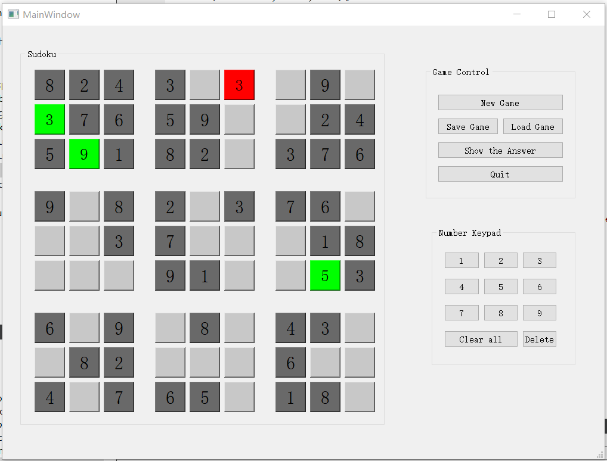
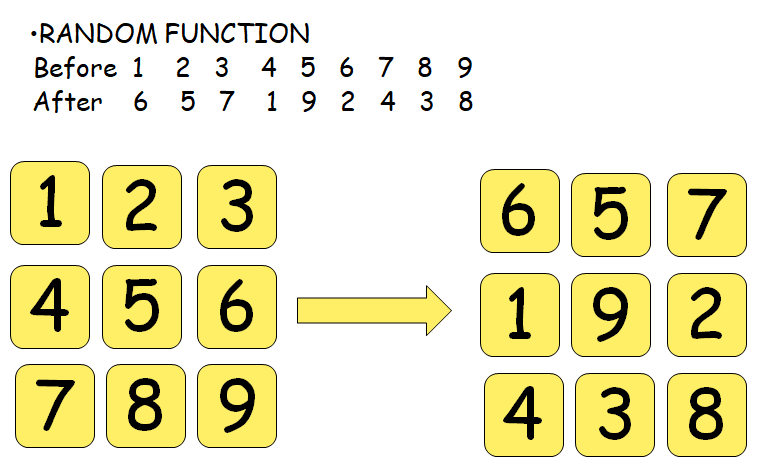
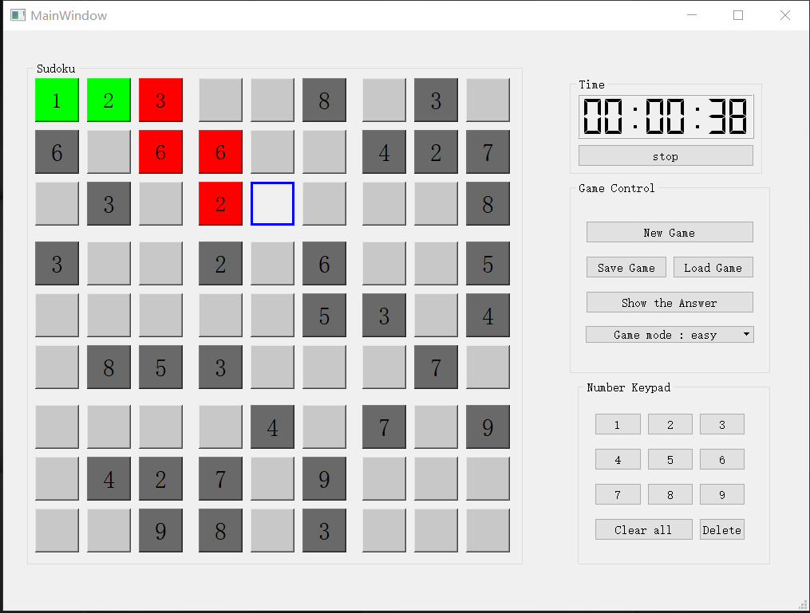
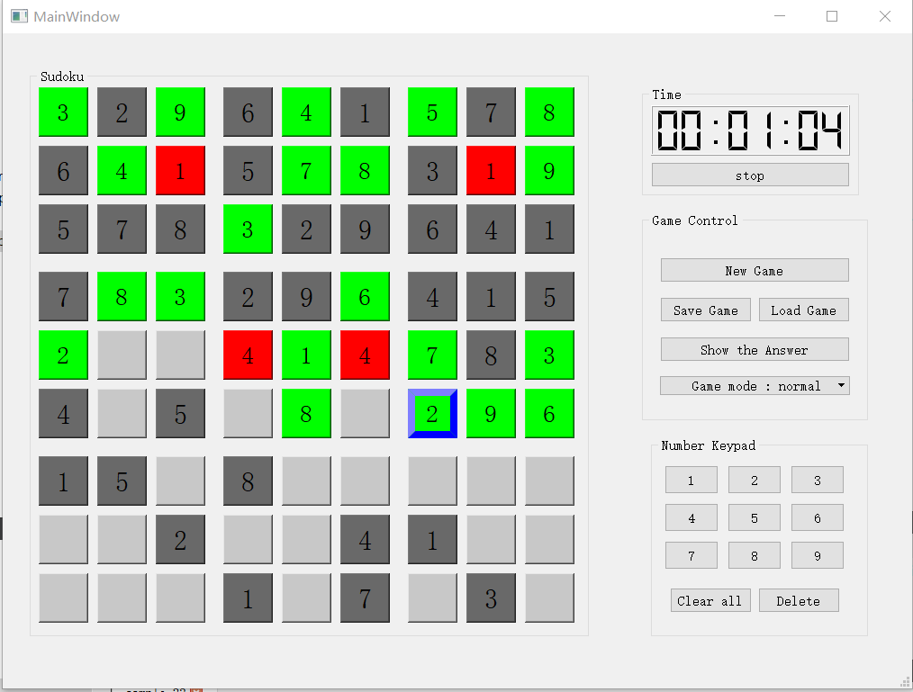

# Sudoku

## 代码重构的建议
* 虽然你用程序生成代码，实现了很多按钮，但是这样的代码非常难维护，可以考虑自己画按钮，如何接收鼠标点击事件，根据鼠标点击的位置判断是那个按钮
* 能够想到用对象的名字来确定是那个按钮被按下了，非常好！不过数字按键的相应，也可以用一样的方式，这样程序就比较简洁。
* 填入数字之后，就把按钮颜色改变，这样的交互可能更好。


## 一. 实现功能简介



Sudoku 可视化界面如上图，有三个分区，并编写了多个方便的按钮，以及键盘快捷键。

### Game Control 区

* New Game / Key_R：开始一局新的游戏。

* Save Game/ Key_E：玩家可以保存游戏进度到本地。

* Load Game/ Key_T: 玩家可以载入已经保存到本地的游戏进度。

* Show the Answer/ Key_G: 对当前游戏调用电脑算法求解并且显示答案。

* Quit /Key_Q : 退出游戏。 

### Number Keypad 区

* 1-9/ Key1-9 ： 对选中的位置赋值。

* Clear all / Key_C : 清除填过的的所有数字，游戏从新开始。

* Delete /Key_Backapce : 清除选中位置的数字。

### Sudoku 区

* 81个格子，数独自带数字为黑褐色，未填区域为白色，所填数字符合规则则为绿色，违规则为红色。

* 点击格子，可在Number Keypad 区进行赋，改，删的操作。

* 也可以用键盘wasd 控制选中格子的位置。

## 二. 算法以及数据结构设计

### 数独的生成

第一个想法就是对一个已有的数独进行指定次数的初等行、列变换（交换），后面没有按这个思路写，感觉不是很有意思，程序里面用的是一种“映射”的方法：默认存储了一个已有数独，每当需要生成新的数独时，随机生成1—9到1—9的映射，映射前后的数字是一一对应的，然后用这个映射关系表对原数独进行改变。原理如下图：



形成新的数独后，随后设定一个控制游戏难度的阈值，对每一个位置做一次随机数，大于阈值则挖空，这样就形成完整的数独，同时通过控制阈值可以控制游戏难度。

### 数独的求解

之前做过一个八皇后的问题，和数独基本类似，写一个递归函数，深度搜索就可以解决，具体思路为：

* 枚举每一个位置，如果是数独初始值就跳过，如果是空位：
** 枚举1~9往空格里填入，如果符合（判断横，竖，小方格），去下一个位置。

除了用算法解数独，还可以用数独生成时的映射表对数独进行反映射，不过我测试了几个数独，即使是比较难的数独也是基本描出答案，程序里的解法就只有DFS

### 数据结构设计

定义了Sudoku 类，代码如下：
```
struct POINT{
    int value;
    bool point_type  ;
    bool point_Islegal = true;
};
class Sudoku
{
public:
    bool b_sign = false;  // true: the sudoke is solved
    POINT sudokuboard[9][9];  // 9*9 points
    int location[2];  // the mouse chose which number to change
    Sudoku();
    bool Check_point_computer(int n, int key);  //check the point's number
    void Check_point_player(int n,int key);
    int SolveSudoku(int n);  // solve the sudoku
    void Check_board();  //use fun:check_point to check every point
    void Input_number();
    void RandomSudoku();  // build a sudoku
};
```
`b_sign`表示游戏是否结束，`sudokuboard[9][9]`即为游戏面板，里面是81个`POINT`，包含了各个位置的数字大小`value`，以及能否被改变`point_type`，是否符合规则`point_Islegal`。`location[2]`为用户当前所选位置。

### 程序设计

头文件`mainwindow.h`和`mainwindow_****.cpp`为GUI界面的绘图以及界面上按钮，键盘输入等的函数程序，例如`mainwindow_gamecontrol.cpp`中即为gamecontrol区的按钮控件的函数，`sudoku.h`和`sudoku.cpp`为与数独算法有关的程序。剩下的一些数学上的小问题（生成随机数，坐标转换等小函数）定义在`tool_function`中。

整个程序其实就是三个部分：全局变量Sudoku类 的new_game,通过按钮或键盘对new_game进行编辑的输入函数，以及每次改变根据最新的new_game更新GUI可视化部分的输出函数。


## 三. GUI 设计

基本就是在QT网格布局下分区，然后排列按钮，之后对每一个按钮的槽函数进行编写。

## 四. 遇到的问题

* 81个数字的面版是按钮排布来的，对这部分按钮的函数进行编写或是根据游戏进行变色的时候要写81遍，最后写了一个输出字符串作为代码的代码，也不算费劲，不过感觉英爱有更好的办法，或是比按钮更合适的控件。

* 保存和读取游戏文件的想法来源于上学期无人机路径规划老师给的二进制文件，这次就想着我也把游戏存为二进制文件。先用`QFileDialog`，获取文件路径，然后用`<fstream>`下的函数进行读写。期间一直报错，想了好久，发现获取的文件路径为Qstring，要转成char才行，否则编译器找不到fstream库下的open函数。

* 对于当前程序，还可以改进的部分：可以做一个计时的部分，以及一个用户控制游戏难度的部分。

## 五. 重构代码

### 大量按钮的编程部分

解决第一个版本需要大量重复槽函数的问题。

按照老师的建议，用代码画按钮，具体实现就是在我所划出的`groupBox_sudoku`中用循环语句，规定按钮大小以及间隔，生成了游戏面板。同时把所有按钮按位置命名，链接到一起，点击时用sender()函数根据信号来源的名字，判断是哪个按钮被选取。
```
    int side = 55;
    int space = 10;
    for (int i = 0; i < 9; i++){
        for(int j = 0;j < 9; j++){
            QPushButton *bt = new QPushButton(QString::asprintf(" "), ui->groupBox_sudoku);
            bt -> setGeometry(space*(j/3+1)+(space+side)*j,10+space*(i/3+1)+(space+side)*i,side,side);
            bt -> setObjectName(QString::asprintf("%d%d", i,j));
            connect(bt,SIGNAL(clicked(bool)),this,SLOT(on_board_clicked()));
```

之后在刷新画面时，可以把按钮全部放到一个Qlist的容器里面，然后就可以用下标进行遍历。
```
QList <QPushButton *> Button_list;
Button_list = ui -> groupBox_sudoku -> findChildren <QPushButton *>();
// 之后就可以以Button_list[i] 进行遍历
```

### 完善了游戏的功能



* 增加了一个效果：被选取的方块边框会显示为蓝色；

* 增加了下拉框选取游戏难度；

* 增加了计时功能，解决了计时功能和开始游戏，保存，载入等的许多逻辑bug。

### 细节优化



按照老师建议，继续做出完善：

* 数字按键的按钮生成以及对应，也用与数独面板一样的方式实现完成。

* 被选取的方块边框会变为蓝色，同时根据填入的数字方块背景实现变色：绿色（当前填入后合法），红色（填入后有重复）。

* 数独类Sudoku只被Mainwindow操作，去掉了全局变量的定义，把他作为一个Mainwindow下的一个变量。
