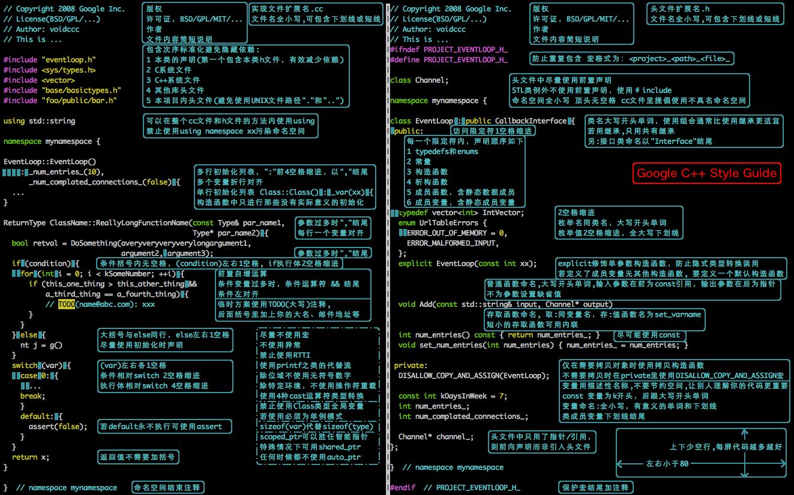

# 命名、编码规范

## 命名规范
正确并形象地给函数、变量、文件命名，不仅可以增加程序的可读性，也是程序员编程风格的一种反映。较好的命名习惯，可以有效的提高程序的可维护性。

命名的基本原则：见名知意，将特性、干什么的、或者什么类型等尽可能描述清楚；命名准确，不引起歧义且长度适中。

不好的命名：
* `system_design` ： 太泛，什么的系统设计？
* `/home/a409/users/xxx/paper/video-base` ： 区分性不好，什么论文的？ 
* `611relativepose` :  数字开头的命名不好，另外更好的表达，应该是这个是干什么的，而不是给谁做的。`relpos_opt` 更好

更多规范可参考 [ 写出漂亮代码的45个小技巧 ](https://juejin.cn/post/7156754418929500168)

## Google编程规范

## 参考

* [ 写出漂亮代码的45个小技巧 ](https://juejin.cn/post/7156754418929500168)