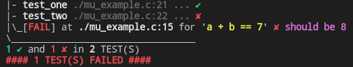

# MiniUnit -- A mini unit test framework for C/C++.
 
README: [English](README.md) | [中文](README_zh.md)

This project is inspired by [MinUnit](http://www.jera.com/techinfo/jtns/jtn002.html), which is a minimal unit testing framework for C. MiniUnit provides more flexible assertions and presents test results with better readability, including display the file name and line number in color text.



MiniUnit is
  - **Simple**: Assert, test, show result, no extra code.
  - **Flexible**: Flexible assertions, optional messages, even with arguments.
  - **Pretty**: Display file name and line number, support color text.
  - **Small**: Only one header file, about 120 lines.

 ## Features

 ### Assertions

  - `mu_assert(expr)` assertion fail if `expr` false
  - `mu_assert(expr, message)` assertion with message
  - `mu_assert(expr, message, args...)` assertion and message with no more than 16 args

### Test function

A test is a function without parameters and return `int`. It return `0` only if all assertions passed. For example,

````c
int test_something()
{
  mu_assert(1 + 1 == 2);
  return 0;  // 0 表示测试通过
}
````

### Run tests

  - `mu_run_test(test)` to run a test function `int test()` which return `0` if passed

### Show results

  - `mu_test_results()` to display the test results

### No color

  - `#define MU_NOCOLOR` if [ANSI escape code]((https://en.wikipedia.org/wiki/ANSI_escape_code)) not supported

````c
#define MU_NOCOLOR
#include "miniunit.h"
````

## Example

For example,

````c
#include "miniunit.h"

int test_one()
{
  mu_assert(2 + 2 == 4);
  return 0; // 0 means test passed
}

int test_two()
{
  int a = 3, b = 5;
  mu_assert(a == 3);
  mu_assert(b == 5, "b is 5");
  mu_assert(a + b == 7, "should be %d", a + b); // fail
  return 0;
}

int main()
{
  mu_run_test(test_one);
  mu_run_test(test_two);

  mu_test_results();

  return 0;
}
````

Output in color mode:


Output in no-color mode:

````
|- test_one ./mu_example.c:21 ... ✔
|- test_two ./mu_example.c:22 ... ✘
|\_[FAIL] at ./mu_example.c:15 for 'a + b == 7' ✘ should be 8
\_________________________________
1 ✔ and 1 ✘ in 2 TEST(S)
#### 1 TEST(S) FAILED ####
````
