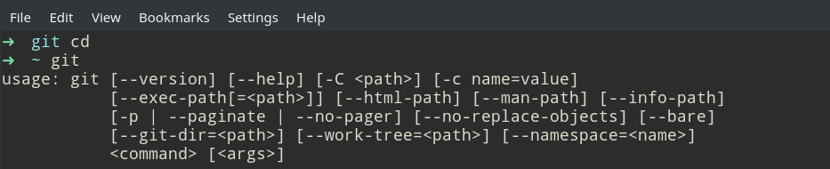
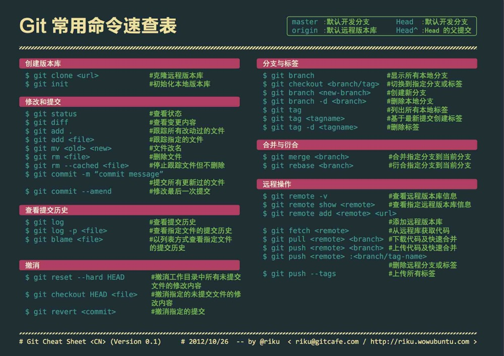

# Git使用教程

Git 不仅仅是个版本控制系统，它也是个内容管理系统(CMS)，工作管理系统等。


## 1. 安装与配置

### 1.1 安装 Git
Windows操作系统：首先下载 https://pc.qq.com/detail/13/detail_22693.html ；然后安装到自己的电脑中。

Linux操作系统下，在终端命令行输入git（PS:以下的命令输入基本都在终端进行）

 

上图表明我的电脑已安装git。若提示git未安装，按照以下命令提示安装。

```
sudo apt-get install git
```

若提示`unable to locate package git`，可能是新装的ubuntu系统没有update,输入`sudo apt-get update`命令，再重复命令`sudo apt-get install git`即可。

### 1.2 配置个人的基本信息
在WIndows下，运行Git的命令行；在Linux下打开命令行终端

输入命令：
```
git config --global user.name <username>
git config --global user.email <email>
```

此步是自报家门：姓名（上例中的`<username>`要替换成你自己的名字）和邮箱地址（上例中的`<email>`，替换成自己邮箱)，这里的名字和邮箱最好是gitee上的保持一致。

`git config`命令的`--global`参数，表明本地电脑所有的git仓库都会使用此配置，当然可以对特定的仓库指定不同的用户名和邮箱。后续的操作都会标记并使用上面设置的用户名和邮箱。

### 1.3 设置SSH公钥
使用SSH提交代码到服务器使用公钥来识别用户身份，因此免去了用户名、密码的输入。

Windows下，在`Git GUI Here`里面的，菜单`Help` - `Show SSH Key`生成SSH公钥，然后把SSH公钥拷贝到粘贴板里。

Linux下，运行下面的命令生成SSH公钥：
```
ssh-keygen -t rsa -C "youremail@xxx.com"
```
然后一路回车，这个会在当前用户文件夹下，生成`~/.ssh`文件夹，里边有个`id_rsa.pub`文件，用文本编辑器（记事本）打开，复制其中的全部内容。 

然后打开 https://gitee.com/profile/sshkeys 页面（如果使用gitee，如果是其他网站则是对应的网址），在该页面中添加公钥，标题可以随便填，公钥就是刚才复制过的内容，然后保存即可。


## 2. 操作已有的仓库的项目

### 2.1 Clone项目到自己的项目
具体见 [如何Fork代码到自己的仓库并clone到本地](https://gitee.com/pi-lab/learn_programming/blob/master/6_tools/git/HowToForkClone.md)


### 2.2 Clone项目到本地
在自己项目的页面，找到`Clone or download`，根据需要选择`SSH`，或者`HTTPS`网址，然后在本地命令行执行如下命令，可以参考[操作页面示例](pic_git/git_clone_code.png)
```
git clone git@192.168.1.3:pi-lab/PIL2.git
```

### 2.3 增加、编辑代码
对本地代码、文件进行编辑、操作

### 2.4 增加、提交到本地仓库

在增加代码到本地仓库前，可以先看一下本地目录有那些改变

```
git status
```

看看是否有不需要增加的文件，如果有则把本地、临时文件等增加到 `.gitignore` 文件里面，例如：

```
build
CMakeList.txt.*
bin
```

然后再通过 `git status`确认是否不需要提交到仓库的文件都忽略了。如果没有问题，则继续执行如下命令提交到本地仓库：

```
git add -A
git commit -m "comments to this revision"
```

### 2.5 将服务器最新代码下载到本地
为了防止服务器上的代码其他人更改，可以现在推送本地文件到服务之前，将服务器最新代码更新到本地
```
git pull origin master
```


### 2.6 提交到服务器
```
git push origin <branchname>
```
其中`<branchname>`一般是`master`


## 3. 创建新的仓库

### 3.1 创建本地仓库
进入到想要设置成为仓库的目录，然后打开终端，或者`Git BASH`。输入下面的命令
```
git init
```

### 3.2 在Gitee上新建项目
登录自己的账号，然后点击Gitee页面的右上角`+`，选择`新建仓库`

输入`仓库名称`（最好是英文），`路径`（必须是英文），以及`仓库介绍`


### 3.3 关联本地仓库与服务器仓库
进入新建的本地仓库，然后输入下面的命令
```
git remote add origin git@gitee.com:pi-lab/project_name.git
```


### 3.4 增加、编辑文件，提交到仓库
在本地文件夹操作，可以增加文件、编辑问题

查看那些文件做了修改
```
git status
```

然后提交到本地仓库
```
git add -A
git commit -m "Message"
```

提交到服务器
```
git push origin master
```


## 4. 操作分支


### 4.1 创建自己的分支（new branch）
```
git checkout -b <branchname>
```

其中 `<branchname>` 是分支名字。

### 4.2 合并其他分支的代码 （高级用法）

```
# 将服务器上的dev分支合并到本地的分支
git pull origin dev
    
# fix some conflicts when occurred，可能会存在冲突，修改冲突
    
# 将修改提交到本地仓库
git add -A
git commit -m "comments to this revision"

# 提交到远端服务器
git push origin <branchname>
```


### 4.3 合并目前代码到`dev`或者`master`分支 （高级用法）

```
git checkout dev
git merge <branchname>
    
# fix some conflicts when occurred，可能会存在冲突，修改冲突
    
git add -A
git commit -m "comments to this revision"

git push origin dev
```


## 5. Git Submodule
submodule是Git中的一个概念，可以将一个git仓库作为另一个git仓库的子目录。例如，我们的项目中需要使用volley库，但是volley库又是一个Git仓库，这时候就可以使用submodule的方式将volley库作为我们项目的子目录。这样做的好处是，我们的项目可以使用volley库的最新版本，而不用担心volley库的更新会影响我们的项目。

### 5.1 下载及同步更新
#### ① 递归clone含有submodule的库

```
git clone --recurse-submodules 仓库地址
```


当已经clone主分支，但没有使用`--recurse-submodules`时，submodule的内容并不会自动下载下来。可以使用如下命令更新submodule
```
git submodule update --init --recursive
```


#### ② 更新仓库及其子仓库

如果过了一段时间volley库有更新，这时候我们的app也需要更新，命令如下：

```
git submodule update
```

### 5.2 当前仓库添加或删除submodule
#### ①添加submodule
```
git submodule add 仓库地址 路径

# 即
git submodule add https://android.googlesource.com/platform/frameworks/volley extras

# 指定分支
git submodule add -b master git@gitee.com:pi-lab/GSLAM.git src/GSLAM
```

这个命令会将volley仓库clone到extras目录下。然后，我们需要将extras目录下的内容提交到git仓库中，命令如下：

```
git add extras
git commit -m "add a submodule"
```

#### ② 删除当前项目的某个submodule

```
git submodule deinit extras
rm -rf .git/modules/extras
rm -f extras

# 打开.gitmodules文件，删除对应的submodule信息
git add .gitmodules # 以及submodule所在目录
git commit -m "remove a submodule"
```

注意: 当在子目录中commit之后，需要在主目录也commit一下，否则主目录的submodule信息不会更新。


### 5.3 删除误放置的代码仓库

例如，删除 `Thirdpart/yaml-cpp`，不作为git submodule:

```
git rm --cached Thirdpart/yaml-cpp
```


## 6. 小技巧

### 6.1 Discard current modification
```
git log # to see which revision want to back, and get the number, eg. "bdc6980"
    
git reset --hard "bdc6980"
```


### 6.2 git使用proxy

设置git的代理服务器
```
git config --global https.proxy 'http://127.0.0.1:8888'
```

或者在`~/.gitconfig`里面加入下面的语句，通过代理服务器访问github。其中1081是代理服务器的端口（可也以是1082, 1083, 1084)
```
[http "https://github.com"]
	proxy = socks5://192.168.1.4:1081
```


### 6.3 git命令行显示中文

将git 配置文件 core.quotepath项设置为false。quotepath表示引用路径
```
git config --global core.quotepath false
```

### 6.4 使用meld作为git对比工具

#### 6.4.1 下载meld

```
sudo apt install meld
```

meld 的基本使用方法，请参考文档

```
man meld
```

#### 6.4.2 设置git diff

```
gedit ~/.gitconfig
```

将下面的内容加入

```
[diff]
	tool = meld
[difftool]
	prompt = false
[difftool "meld"]
	cmd = meld "$LOCAL" "$REMOTE"
```

#### 6.4.3 使用

当我们进行版本比较的时候

```
git difftool -d 版本1 版本2
```

会自动比较文件夹下的所有内容

## 7. 在项目中使用Git的技巧

### 7.1 Git操作的好习惯
* 不用非得等程序等都写完才提交到git仓库。最好每天有阶段的成果的时候就提交到仓库，把comments写清楚就好
* 循环迭代的方式是一个很好的方式，能够有效克服眼高手低，克服畏难情绪。虽然刚开始做的比较简单，但是只要开始，通过不断的迭代，持续不断总能提高
* 不要高估自己的记忆力，勤动手有效克服自己错误的认识
* 除了管理代码，Latex论文，研究思路，技术路线，相关文献等都可以使用git管理。例如 https://gitee.com/pi-lab/research_change_detection
* 每次操作之前，最好 `git pull origin master`，将服务器最新的版本更新到本地，这样的操作尽可能减少冲突的发生的情况
* 可以构建一个索引将所有的项目管理起来（例如 https://gitee.com/pi-lab/pilab_research_fields），通过构建一个图（其实就是知识图谱），将各种知识、项目等连接起来，从而构建自己的知识、技能、思维体系，成体系的知识、技能才能发挥更大的作用。
* [HSMM-Network项目](https://gitee.com/pi-lab/hsmm-network) 是一个典型例子，没有使用git管理，很难复现当时的程序，通过完整的`README.md`说明程序的结构、数据集、运行方法，能够很快复现前人的工作
* 为了将一份代码同时保管在多个代码仓库，可以设置多个`git remote`，例如 `git remote add gitee git@gitee.com:pi-lab/learn_hardware.git`，这样可以将本地的代码同时提交到多个服务器
* git仓库最好不要放特别大的文件，例如模型、训练数据等。一个比较好的解决办法是，将这些大文件放到服务器的一个目录，然后在项目的`README.md`中，写下数据文件的目录。


### 7.2 如何在ROS项目中使用

方法一：

由于ROS需要把代码放到 `~/catkin_ws/src/`，因此为了能继续使用git，可以把git项目的目录放在其他地方，例如`~/git_ws/crossing_circle`，通过符号链接的方式，将其他目录的ROS代码引入到ROS的编译目录。

```
cd ~/catkin_ws/src/
ln -s ~/git_ws/crossing_circle crossig_circle
```

方法二:

新建一个ros空间，任意起名即可，如PX4_ws,然后在里面创建src文件夹，将git上的代码下载到src文件

```
cd ~/PX4_ws/
catkin_make
source devel/setup.bash
```


### 7.3 项目中除了代码，还有很多数据文件

如果数据文件不大的情况下，可以把数据、程序放到一起利用 git 管理；但是一般的做法是，把数据单独放到一个目录，代码放到另一个目录，在代码的目录里 `README.md` 里面写清楚，数据文件的路径。

如果项目中很多本地文件、临时文件不需要让git管理，可以设置 [.gitignore 文件](gitignore.md)，这个文件可以放在仓库的根目录，或者需要起作用的目录。

在程序中尽可能不要把路径写死，可以通过参数配置读取的方式，如果是C++项目可以使用 `Svar`, 如果是Python程序可以使用 `pconf`
* C++的配置读取示例： [svar_argparse](https://gitee.com/pi-lab/code_cook/tree/master/c++/argparse/svar_argparse)
* Python的配置读取示例： [pconf](https://gitee.com/pi-lab/code_cook/tree/master/python/pconf)


## 8. Git常用命令速查表




## 9. 参考资料

### 9.1 基础教程
* [Git快速入门 - Git初体验](https://my.oschina.net/dxqr/blog/134811)
* [在Win7系统下使用TortoiseGit(乌龟git)简单操作Git](https://my.oschina.net/longxuu/blog/141699)


### 9.2 系统教程
* [Git简明教程.md](git简明教程.md)
* [Git教程.pdf](Git教程.pdf)
* [Git系统学习 - 廖雪峰的Git教程](https://www.liaoxuefeng.com/wiki/0013739516305929606dd18361248578c67b8067c8c017b000)


### 9.3 实验室常用功能介绍
* [PILAB的Git使用教程](Git使用教程_PILAB.pdf)
* [如何Fork代码到自己的仓库并clone到本地](HowToForkClone.md)
* [如何在Gitee添加其他用户](gitee_addmember.md)


### 9.4 参考手册等
* [Git Cheatsheet](git-cheatsheet.pdf)
* [Git常用命令](git-cheatsheet_cn.jpg)
* [Git大全](https://gitee.com/all-about-git)
