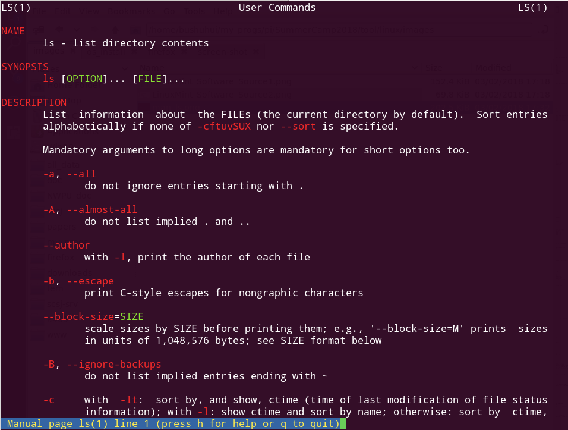
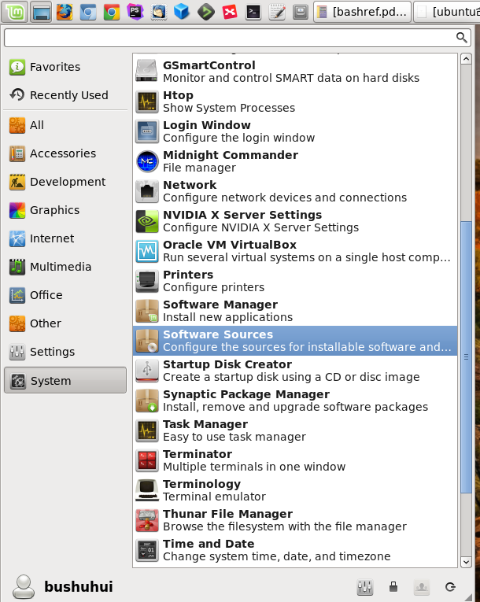
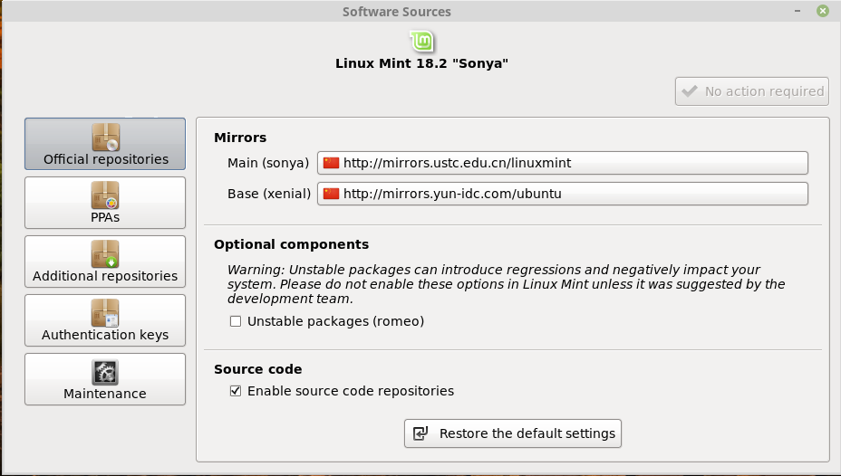

# Linux入门

## 1. 概述

### 1.1 Linux是什么
linux是一种自由和开放源码的类Unix操作系统，其不同于windows的不可更改性，可以对源码进行修改，并且可以免费进行使用，其基于POSIX和Unix的多用户、多任务、支持多线程和多CPU的操作。linux主要的发行版有：**Ubuntu**、**RedHat**、**CentOS**、Debain、Fedora、SuSE、OpenSUSE.

### 1.2 为什么要学习和使用Linux

如果不知道到为什么，不理解，那么就先尝试去学习，并努力去使用，搞研究和开发的大牛都在用，所以一定有其内在的道理。需要强迫自己用上一段时间Linux来进行程序开发，文档编写等等。当你习惯了之后就会很清楚的知道为什么了。

在Linux学习过程，刚开始需要记忆常用的命令，多反思这些命令灵活的组合。

### 1.3 Linux的应用领域
1. 个人桌面领域
2. 服务器领域（免费、稳定、高效）
3. 嵌入式领域


### 1.4 使用Linux的好处
虽然刚开始使用Linux会发现到处都是坑，处处都能遇到问题，但是当你一旦会使用之后你就会发现Linux有非常多的优点，足以弥补你之前解决问题所花的时间。

目前在计算机视觉、机器学习，计算机的大多数领域，Linux提供了大量的开源代码和工具，通过一个简单的命令行就可以自动的完成大多数软件的安装，能够极大的节省自己的时间（但前提是你需要知道如何找到这些软件名字）；此外，Linux下面没有烦人的弹出框，能让你更加集中精力在学习和工作上。

主要的优点：
1. 有大量的开源程序、软件
2. 通过一个命令行能够安装你所需要的软件
3. 可以编写脚本，自动执行非常复杂的任务
4. 机器学习的大部分的程序需要在Linux运行，避免大量移植代码到Windows下所可能遇到的问题
5. 系统比较纯净，一般不需要安装杀毒软件，同样的配置Linux下执行大部分软件更流程


### 1.5 安装Linux
第一次使用Linux，并且安装Linux会是一个比较难、会遇到很多问题的过程。但是需要坚持下来，因为这个过程会学到很多解决实际问题的经验。在这个过程琢磨如果遇到问题，怎么去找解决办法等等。

下载安装的ISO文件，可以通过国内镜像网站下载：
* https://mirrors.tuna.tsinghua.edu.cn/ubuntu-cdimage/
* https://developer.aliyun.com/mirror/ 点击`OS镜像`，然后选择版本


建议参考下面的说明文档：
* [Ubuntu安装最佳实践（防踩坑指南）](https://zhuanlan.zhihu.com/p/114518326)
* [VirtualBox 安装 Ubuntu 开发环境详细图文教程](https://zhuanlan.zhihu.com/p/35619204)

由于直接使用系统默认的源比较慢，所以安装好系统之后，尽快把软件源替换成国内的镜像。
* https://developer.aliyun.com/mirror/ubuntu
* https://mirrors.tuna.tsinghua.edu.cn/help/ubuntu/


## 2. 需要掌握的基本

### 2.1 命令行操作
* `<>`表示必须输入参数
* `[]`表示可选的输入参数
* Linux终端里面的命令几乎都是以命令 [选项] [参数] 的格式来进行输入的
* 命令这一部分肯定是存在
* 选项和参数不一定存在，可有可无。 选项和参数取决于你使用该命令实现的具体目的。
* 选项是以 ` -  ` 来指明的
* 命令、选项、参数之间是以空格来隔开的， 一个或多个空格都视为1个空格
* 完成linux命令输入后，按下enter键，即可执行该命令。

### 2.2 目录结构
linux的文件系统是采用级层式的树状目录结构，在此结构中的最上层是根目录`/`，然后在此目录下再创建其他的目录。

目录具体存放内容可参考以下文档 https://zhuanlan.zhihu.com/p/60423235


### 2.3 Linux文件夹简介
* `/` 这是根目录（文件夹），文件系统树的根。
* `/bin` 包含二进制文件，系统启动需要的可执行程序。
* `/boot` 包含机器启动时所需的内核和文件。
* `/dev` 包含设备节点，与连接到计算机的物理设备一起使用的指令/接口。
* `/etc` 包含系统范围的配置文件（发音为etsy），大型软件包（如gtk，python，X11）一般也在此处存储配置文件。
* `/home` 包含系统用户的目录（每个用户的下载、图片等）。
* `/lib` 包含启动计算机的核心程序所必需的共享库。
* `/lost+found` 包含由于系统崩溃或驱动器错误而放错位置的数据。
* `/media` 包含用于USB、CD和DVD等媒体设备的安装点。
* `/mnt` 是临时文件系统的挂载点（例如用来安装系统的内容。
* `/opt` 包含程序的其他程序包。在我的机器中，Google Chrome和Minecraft Launcher将文件保存在此处。
* `/proc` 包含与内核和正在运行的进程有关的文件。
* `/tmp` 包含在执行程序时可能创建的临时文件。
* `/usr` 包含一个次要的只读系统树，用于与某些程序共享或用于安装在其他Linux系统上。上面存在许多目录也存在这里，并包含一些其他文件。
* `/var` 包含随时间变化其大小发生变化的文件，例如日志和备份。


### 2.4 绝对路径与相对路径
根据档名写法的不同，也可将所谓的路径(path)定义为绝对路径(absolute)与相对路径(relative)。 这两种文件名/路径的写法依据是这样的：
1. 绝对路径：由根目录(`/`)开始写起的文件名或目录名称， 例如 `/home/dmtsai/.bashrc`
2. 相对路径：相对于目前路径的文件名写法。 例如 `./home/dmtsai` 。反正开头不是 `/` 就属于相对路径的写法

### 2.5 `sudo`临时切换身份到root
Debian, Ubuntu， LinuxMint等系统默认是不让直接使用root身份，所以安装软件、或者操作系统文件的时候需要临时切换身份。

**重要！！！重要！！！ 直接使用会导致操作系统被损坏，而且直接使用root这个习惯非常恶劣！需要养成不使用root的习惯！**

安装软件：
```
sudo apt-get install p7zip-full
```

临时切换成管理员：
```
sudo su
```


## 3. 常用指令（用户管理）
linux系统是一个多用户多任务的操作系统，任何一个要使用系统资源的用户，都必须首先向系统管理员申请一个账号，然后以这个账号的身份进入系统。

### 1) 添加用户
* 基本语法：`useradd 用户名`
*  添加一个用户wuyifan，默认该用户的家目录在/home/wuyifan，当创建用户成功后，会自动创建和用户同名的家目录。
*  也可以通过`useradd -d 指定目录 用户名`，给新创建的用户指定家目录。
*  通过命令`passwd 用户名`给用户设定密码

```
zm@zm-VirtualBox:~$ sudo useradd wuyifan
zm@zm-VirtualBox:~$ sudo passwd wuyifan
输入新的 UNIX 密码： 
重新输入新的 UNIX 密码： 
passwd：已成功更新密码
```


### 2) 删除用户
* 基本语法：`userdel 用户名`
* 删除用户wuyifan，但是要保留家目录，`userdel wuyifan`
* 删除用户以及用户主目录，`userdel  -r wuyifan`

### 3)查询用户信息指令
* 基本语法：`id 用户名`

```
zm@zm-VirtualBox:~$ id zm
uid=1000(zm) gid=1000(zm) 组=1000(zm),4(adm),24(cdrom),27(sudo),30(dip),46(plugdev),116(lpadmin),126(sambashare)
```


### 4)切换用户
* 基本语法：`su 切换用户名`
* 在操作Linux中，如果当前用户的权限不够，可以切换到高权限用户，比如root
* 从高权限用户切换至权限低的用户，不需要输入密码，反之需要。
* 当需要返回到原来用户时，使用exit/logout指令。

### 5)查询当前用户/登录用户
* 基本语法：`whoami/who am i`

### 6)用户组
类似于角色，系统可以对有共性/权限的多个用户进行统一的管理，新建用户默认情况下会生成与用户名相同的用户组。
* 新增组：`groupadd 组名`
* 删除组：`groupdel 组名`
* 增加用户时指定组`useradd -g 用户组 用户名 `
* 修改用户的组：`usermod -g 用户组 用户名`


## 4. 常用指令（文件目录）

### 1) 查看命令的使用说明
1. 初学者，能够灵活的使用`man`命令，能够极大的提高学习的速度。大多数的Linux命令都有在线的使用手册，因此通过man命令能够让你在不清楚命令参数的情况下，快速的学到用法。基本的用法是`man <command>`
2. help命令同样也能够查看命令的使用说明，基本的用法是`<command> --help`

基本的用法是`man <command>`



由于man使用了`vim`的键盘设置，因此能够使用快捷键来操作

| 按键         | 动作             | 
| --------    | --------        |
| `j`         | 向下翻一行
| `k`         | 向上翻一行        |
| `（ctrl+d）`    | 向下翻一屏        |
| `（ctrl+u）`    | 向上翻一屏        |
| `/keyword`  | 搜索关键词keyword |
| `n`         | 下一个搜索关键词出现的地方 |
| `N`         | 上一个搜索关键词出现的地方 |
| `gg`        | 说明文档的最上面   |


### 2) `ls` 查看当前目录下的文件
```
SummerCamp2018@T470p> ls
ai/  cpp/  python/  slam/  tool/  book.json  contribute.md  README.md  SUMMARY.md
```
`ls`后可跟参数。`ls -l`以列表的形式显示信息，`ls -l`可缩写为`ll`,`ls -a`显示所有文件与文件夹，包括隐藏文件夹.和..等，`ls -i`显示文件索引节点号(inode)，一个索引节点代表一个文件。
```
SummerCamp2018@T470p> ll
total 28
drwxrwxr-x 8 bushuhui bushuhui    93 Mar  1 11:17 ai/
drwxrwxr-x 5 bushuhui bushuhui    41 Mar  1 11:17 cpp/
drwxrwxr-x 5 bushuhui bushuhui    51 Mar  1 11:17 python/
drwxrwxr-x 7 bushuhui bushuhui    88 Mar  1 11:17 slam/
drwxrwxr-x 9 bushuhui bushuhui   103 Mar  1 11:17 tool/
-rw-rw-r-- 1 bushuhui bushuhui  2427 Mar  1 11:17 book.json
-rw-rw-r-- 1 bushuhui bushuhui  1011 Mar  1 11:17 contribute.md
-rw-rw-r-- 1 bushuhui bushuhui 13133 Mar  1 11:17 README.md
-rw-rw-r-- 1 bushuhui bushuhui  2892 Mar  1 11:17 SUMMARY.md
```
参数选项可以组合使用。

```
zm@zm-VirtualBox:~$ ls -al
总用量 96
drwxr-xr-x 15 zm   zm   4096 8月  12 15:52 .
drwxr-xr-x  4 root root 4096 8月  12 12:20 ..
-rw-------  1 zm   zm    309 8月  12 15:52 .bash_history
-rw-r--r--  1 zm   zm    220 8月  12 10:10 .bash_logout
-rw-r--r--  1 zm   zm   3771 8月  12 10:10 .bashrc
drwx------ 11 zm   zm   4096 8月  12 15:52 .cache
drwx------ 11 zm   zm   4096 8月  12 15:52 .config
drwx------  3 zm   zm   4096 8月  12 12:16 .gnupg
-rw-------  1 zm   zm    692 8月  12 12:15 .ICEauthority
drwx------  3 zm   zm   4096 8月  12 11:33 .local
-rw-r--r--  1 zm   zm    807 8月  12 10:10 .profile
drwx------  2 zm   zm   4096 8月  12 12:16 .ssh
-rw-r--r--  1 zm   zm      0 8月  12 11:51 .sudo_as_admin_successful
-rw-r-----  1 zm   zm      5 8月  12 12:15 .vboxclient-clipboard.pid
-rw-r-----  1 zm   zm      5 8月  12 12:15 .vboxclient-display-svga-x11.pid
-rw-r-----  1 zm   zm      5 8月  12 12:15 .vboxclient-draganddrop.pid
-rw-r-----  1 zm   zm      5 8月  12 12:15 .vboxclient-seamless.pid
drwxr-xr-x  2 zm   zm   4096 8月  12 11:33 公共的
drwxr-xr-x  2 zm   zm   4096 8月  12 11:33 模板
drwxr-xr-x  2 zm   zm   4096 8月  12 11:33 视频
drwxr-xr-x  2 zm   zm   4096 8月  12 11:33 图片
drwxr-xr-x  2 zm   zm   4096 8月  12 11:33 文档
drwxr-xr-x  2 zm   zm   4096 8月  12 11:33 下载
drwxr-xr-x  2 zm   zm   4096 8月  12 11:33 音乐
drwxr-xr-x  2 zm   zm   4096 8月  12 11:33 桌面

```


### 3) `pwd`显示当前工作目录的绝对路径
```
linux@T470p> pwd
/home/bushuhui/my_progs/pi/SummerCamp2018/tool/linux
```
### 4) `cd` 切换到一个指定的目录，或者进入`home`目录

进入到一个目录
```
SummerCamp2018@T470p> ls
ai/  cpp/  python/  slam/  tool/  book.json  contribute.md  README.md  SUMMARY.md
SummerCamp2018@T470p> cd tool/linux/
linux@T470p> ls
docs/  exercise/  linux.pptx*  README.md
```

进入到`home`目录
```
linux@T470p> cd
~@T470p> pwd
/home/bushuhui
```

`cd ~`或者`cd`回到自己的家目录
```
zm@zm-VirtualBox:~$ cd 桌面/文件夹/文件夹1
zm@zm-VirtualBox:~/桌面/文件夹/文件夹1$ cd
zm@zm-VirtualBox:~$ 
```
```
zm@zm-VirtualBox:~$ cd 桌面/文件夹/文件夹1
zm@zm-VirtualBox:~/桌面/文件夹/文件夹1$ cd ~
zm@zm-VirtualBox:~$ 

```
`cd  ..`回到当前目录的上一级目录


```
zm@zm-VirtualBox:~/桌面/文件夹/文件夹1$ cd ..
zm@zm-VirtualBox:~/桌面/文件夹$ 
```


### 5）`mkdir`生成一个目录
`mkdir`默认只能生成一级目录
```
zm@zm-VirtualBox:~/桌面$ mkdir animal
zm@zm-VirtualBox:~/桌面$ ls
animal
```
命令`mkdir -p`能生成多级目录

```
zm@zm-VirtualBox:/home$ mkdir -p /home/zm/桌面/animal/tiger
zm@zm-VirtualBox:/home$ cd /home/zm/桌面/animal
zm@zm-VirtualBox:~/桌面/animal$ ls
tiger
zm@zm-VirtualBox:~/桌面/animal$ 

```
`rmdir`指令可删除空目录

### 6）`touch`指令创建空文件
```
zm@zm-VirtualBox:~$ cd /home/zm/桌面/animal/tiger
zm@zm-VirtualBox:~/桌面/animal/tiger$ sudo touch xx.txt
[sudo] zm 的密码： 
zm@zm-VirtualBox:~/桌面/animal/tiger$ ls
xx.txt
```
### 7）`cp`拷贝指令
`cp`指令拷贝文件到指定目录
* 基本语法：`cp [选项] source dest`

```
zm@zm-VirtualBox:~$ cd 桌面/mountain
zm@zm-VirtualBox:~/桌面/mountain$ cd
zm@zm-VirtualBox:~$ cd 桌面/animal/tiger
zm@zm-VirtualBox:~/桌面/animal/tiger$ ls
xx.txt
zm@zm-VirtualBox:~/桌面/animal/tiger$ sudo cp xx.txt /home/zm/桌面/mountain
[sudo] zm 的密码： 
zm@zm-VirtualBox:~/桌面/animal/tiger$ cd
zm@zm-VirtualBox:~$ cd 桌面/mountain
zm@zm-VirtualBox:~/桌面/mountain$ ls
xx.txt

```
* `cp -r source dest`递归复制整个文件夹
```
zm@zm-VirtualBox:~$ cd 桌面/mountain
zm@zm-VirtualBox:~/桌面/mountain$ ls
xx.txt
zm@zm-VirtualBox:~$ cd 桌面/animal
zm@zm-VirtualBox:~/桌面/animal$ ls
lion  tiger
zm@zm-VirtualBox:~/桌面/animal$ sudo cp -r /home/zm/桌面/animal /home/zm/桌面/mountain
zm@zm-VirtualBox:~/桌面/animal$ cd
zm@zm-VirtualBox:~$ cd 桌面/mountain
zm@zm-VirtualBox:~/桌面/mountain$ ls
animal	xx.txt
```

### 8）`rm`指令
`rm`指令移除文件或目录
* 基本语法：`rm [选项] 要删除的文件或目录`
* 常用选项：`-r`：递归删除整个文件夹
                     `-f`：强制删除不提示
```
zm@zm-VirtualBox:~/桌面/mountain$ ls
animal	xx.txt
zm@zm-VirtualBox:~/桌面/mountain$ sudo rm xx.txt
[sudo] zm 的密码： 
zm@zm-VirtualBox:~/桌面/mountain$ ls
animal
```


删除一个目录
```
zm@zm-VirtualBox:~/桌面/mountain/animal$ ls
mountain  tiger
zm@zm-VirtualBox:~/桌面/mountain/animal$ cd ..
zm@zm-VirtualBox:~/桌面/mountain$ sudo rm -r animal
zm@zm-VirtualBox:~/桌面/mountain$ ls
zm@zm-VirtualBox:~/桌面/mountain$ 
```
### 9）`mv`指令
`mv`移动文件与目录或重命名
* 基本语法：`mv  oldNameFile newNameFile`（功能描述：重命名）

```
zm@zm-VirtualBox:~/桌面$ ls
animal	mountain
zm@zm-VirtualBox:~/桌面$ sudo mv animal test
[sudo] zm 的密码： 
zm@zm-VirtualBox:~/桌面$ ls
mountain  test 
```

* 基本语法：`mv  /temp/movefile /targetFolder`（功能描述：移动文件）

```
zm@zm-VirtualBox:~/桌面/mountain$ ls
flower
zm@zm-VirtualBox:~/桌面/mountain$ cd
zm@zm-VirtualBox:~$ cd 桌面/test
zm@zm-VirtualBox:~/桌面/test$ ls
lion  tiger
zm@zm-VirtualBox:~/桌面/test$ cd
zm@zm-VirtualBox:~$ sudo mv 桌面/mountain/flower 桌面/test
zm@zm-VirtualBox:~$ cd 桌面/mountain
zm@zm-VirtualBox:~/桌面/mountain$ ls
zm@zm-VirtualBox:~/桌面/mountain$ cd
zm@zm-VirtualBox:~$ cd 桌面/test
zm@zm-VirtualBox:~/桌面/test$ ls
flower	lion  tiger
```

### 10）`cat`指令
`cat`查看文件内容
* 基本语法：`cat [选项]  要查看的文件`
* 常用选项：`-n`显示行号
* `cat`只能浏览文件，而不能修改文件，为了浏览方便，一般会带上**管道命令**`|more`
```
zm@zm-VirtualBox:~$ cat -n 文档/test
     1	summer camp
     2	linux
     3	summer camp
     4	linux
     5	
```

### 11）`more`指令
`more`指令是一个基于VI编辑器的文本过滤器，它以全屏幕的方式按页显示文本文件的内容。more指令中内置了若干快捷键（交互的指令），详见操作说明。
* 基本语法：`more 要查看的文件`

| 按键                | 动作     |
| --------           | --------|
| `b`                | 向上翻一页|
| `空白键（space）`   | 向下翻一页
| `Enter`           | 向下翻一行 |
| `q`                | 不再显示该文件内容|
| `ctrl+F`          | 向下翻一屏|
| `ctrl+B`         | 返回上一屏|
| `=`             | 输出当前行的行号|
| `：f`           | 输出文件名和当前行的行号 |

### 12）`head`指令
`head`指令用于显示文件的开头部分的内容，默认情况下`head`指令显示文件的前十行内容
* 基本语法：`head 文件`（功能描述：查看文件头10行内容）
* `head -n 5 文件`（功能描述：查看文件头5行内容）

```
zm@zm-VirtualBox:~$ head -n 5 文档/test
1 summer camp
2linux
3summer camp
4linux
5summer camp
```
### 13）`tail`指令
`tail`指令用于输出文件中尾部的内容，默认情况下`tail`指令显示文件的前十行内容
* 基本语法：`tail 文件`（功能描述：查看文件尾10行内容）
* `tail -n 5 文件`（功能描述：查看文件尾5行内容）

```
zm@zm-VirtualBox:~$ tail -n 5 文档/test
17summer camp
18linux
19summer camp
20linux

```

### 14）`echo`指令
`echo`指令输出内容到控制台
* 基本语法：`echo 输出内容`
使用`echo`指令输出hello,world

```
zm@zm-VirtualBox:~$ echo hello world
hello world
zm@zm-VirtualBox:~$ echo "hello world"
hello world
```
### 15）`>`指令和`>>`指令
`>`输出重定向和`>>`追加
* 基本语法：`ls -l> 文件`（功能描述：列表的内容写入到文件中，将文件中的原有内容覆盖）
* 基本语法：`ls -l>> 文件`（功能描述：列表的内容追加到文件的末尾）
* 基本语法：`cat 文件1> 文件2`（功能描述：文件1的内容覆盖到文件2中）
* 基本语法：`echo "内容">> 文件`（功能描述：将内容追加到到文件末尾）

使用`echo`命令在文件末尾追加`hello world`
```
zm@zm-VirtualBox:~$ echo "hello world">> 文档/test
zm@zm-VirtualBox:~$ tail -n 5 文档/test
18linux
19summer camp
20linux

hello world
```
使用`ls l`命令覆盖文件原有内容
```
zm@zm-VirtualBox:~$ ls -l
总用量 32
drwxr-xr-x 2 zm   zm   4096 8月  13 10:33 公共的
drwxr-xr-x 2 zm   zm   4096 8月  13 10:33 模板
drwxr-xr-x 2 zm   zm   4096 8月  13 10:33 视频
drwxr-xr-x 2 zm   zm   4096 8月  13 10:33 图片
drwxr-xr-x 2 zm   zm   4096 8月  13 16:24 文档
drwxr-xr-x 2 zm   zm   4096 8月  13 10:33 下载
drwxr-xr-x 2 zm   zm   4096 8月  13 10:33 音乐
drwxr-xr-x 4 root root 4096 8月  13 12:12 桌面
zm@zm-VirtualBox:~$ ls -l > 文档/test
zm@zm-VirtualBox:~$ cat 文档/test
总用量 32
drwxr-xr-x 2 zm   zm   4096 8月  13 10:33 公共的
drwxr-xr-x 2 zm   zm   4096 8月  13 10:33 模板
drwxr-xr-x 2 zm   zm   4096 8月  13 10:33 视频
drwxr-xr-x 2 zm   zm   4096 8月  13 10:33 图片
drwxr-xr-x 2 zm   zm   4096 8月  13 16:24 文档
drwxr-xr-x 2 zm   zm   4096 8月  13 10:33 下载
drwxr-xr-x 2 zm   zm   4096 8月  13 10:33 音乐
drwxr-xr-x 4 root root 4096 8月  13 12:12 桌面

```

### 16) `ln`指令
软链接也称符号链接，类似于windows中的快捷方式，主要存放了链接其他文件的路径。**使用这个命令的好处是不用将文件拷贝一份，可直接将其放置到另外一个目录中。**
* 基本语法：`ln -s [原文件或目录][软链接名]`（功能描述：给原文件创建一个软链接）
* 当使用`pwd`指令查看目录时，依然看到的是软链接所在目录

```
linux@T470p> ln -s docs/unixtoolbox.pdf unixtoolbox.pdf
linux@T470p> ll
total 400
drwxrwxr-x 2 bushuhui bushuhui    268 Mar  2 11:19 docs/
drwxrwxr-x 2 bushuhui bushuhui     23 Mar  1 11:17 exercise/
-rwxrwxr-x 1 bushuhui bushuhui 401292 Mar  1 11:17 linux.pptx*
-rw-rw-r-- 1 bushuhui bushuhui   7695 Mar  2 15:35 README.md
lrwxrwxrwx 1 bushuhui bushuhui     20 Mar  2 15:37 unixtoolbox.pdf -> docs/unixtoolbox.pdf
```

### 17） `history` 
查看已经执行过的历史命令，也可以执行历史指令

* 基本语法：`history`（功能描述：查看已经执行过的历史指令）
* `history 10`（功能描述：查看最近使用过的10个指令）
* ！5`（功能描述：执行历史编号为5的指令）
```
tem@T470p> history 
 4031  ls
 4032  ll
 4033  cd conf/
 4034  ls
 4035  ll
 4036  vi enable-php.conf 
 4037  vi fastcgi_params
 ...
```
## 5. 常用指令（时间日期）
### 1） `date` 指令
显示当前日期

* 基本语法：`date`（功能描述：显示当前日期）
* 基本语法：`date+%Y`（功能描述：显示当前年份）
* 基本语法：`date+%m`（功能描述：显示当前月份）
* 基本语法：`date+%d`（功能描述：显示当前是哪一天）
* 基本语法：`date "+%Y-%m-%d%H:%M:%S"`（功能描述：显示年月日时分秒）
```
zm@zm-VirtualBox:~$ date
2021年 08月 15日 星期日 10:43:27 CST
zm@zm-VirtualBox:~$ date "+%Y-%m-%d %H:%M:%S"
2021-08-15 10:43:32
```
* 基本语法：`date -s "2020-11-03 20:02:10"`（功能描述：设置系统当前时间为2020-11-03 20:02:10）
### 2） `cal` 指令
查看日历指令
* 基本语法：`cal[选项]`（功能描述：不加选项，显示本月日历）
* `cal 2020`显示2020年日历
```
zm@zm-VirtualBox:~$ date
2021年 08月 15日 星期日 10:43:27 CST
zm@zm-VirtualBox:~$ date "+%Y-%m-%d %H:%M:%S"
2021-08-15 10:43:32
```

## 6. 常用指令（时间日期）
### 1) `find`指令
`find`指令将从指定目录向下递归地遍历其各个子目录，将满足条件的文件或者目录显示在终端
* 基本语法：`find [搜索范围] [选项]`
选项说明：

| 选项                | 功能    |
| --------           | --------|
| `-name<文件名>`      | 按照指定的文件名查找模式查找文件|
| `-user<用户名>`   | 查找属于指定用户名所有文件
| `-size<文件大小>`        | 按照指定的文件大小查找文件 |
| `-mtime<天数>`        | 按照修改时间在几天之内查找文件 |
找当前目录下所有符合正则表达的文件名的文件，`find -name *pdf`
```
linux@T470p> find -name *pdf
./docs/Bash-Beginners-Guide.pdf
./docs/bashref.pdf
./docs/Linux_Complete_Command_Line.pdf
./docs/unixtoolbox.pdf
./docs/unix_toolbox_cn.pdf
./docs/鸟哥的Linux私房菜基础篇-第三版.pdf
./docs/ubuntu命令行简明教程.pdf
```
查找整个linux系统下大于200M的文件（+n 大于 -n小于 n等于，单位有k，m，G
```
linux@T470p> find .  -mtime -2
zm@zm-VirtualBox:~$ sudo find / -size +300M
/proc/kcore
```
找到给定目录下所有修改时间在2天之内的文件 `find . -mtime -2`
```
linux@T470p> find .  -mtime -2
.
./docs
./docs/Bash-Beginners-Guide.pdf
./docs/bashref.pdf
./exercise
./exercise/README.md
./linux.pptx
./README.md
```

找到文件之间执行特定的命令，例如删除：`find . -type f -mtime -2 | xargs rm -rf`
```
linux@T470p> find . -type f -mtime -2 
./linux.pptx
./README.md
./docs/Bash-Beginners-Guide.pdf
./docs/bashref.pdf
./exercise/README.md
linux@T470p> find . -type f -mtime -2 | xargs rm -rf
linux@T470p> find . -type f -mtime -2 
linux@T470p> 
```

### 2）`locate`指令
`locate`指令可以快速定位文件路径，`locate`指令利用事先建立的系统中所有文件名称及路径的`locate`数据库实现快速定位给定的文件，`locate`指令无需遍历整个文件系统，查询速度较快。为了保证查询结果的准确度，管理员必须定期更新`locate`时刻。
* 基本语法：`locate 搜索文件`（由于`locate`指令基于数据库进行查询，所以第一次运行前，必须使用`updatedb`指令创建`locate`数据库。)
```
linux@T470p> locate -b linuxmint # 其中-b表示只是找文件名中包含指定字符串的文件
/etc/linuxmint
/etc/default/grub.d/50_linuxmint.cfg
/etc/lightdm/lightdm-gtk-greeter.conf.d/99_linuxmint.conf
/etc/lightdm/lightdm.conf.d/70-linuxmint.conf
/home/bushuhui/.linuxmint
...
```

也可以通过管道来配合`grep`过滤
```
linux@T470p> locate linuxmint | grep iso # 通过 grep 过滤只留下包含iso的文件
/home/soft/os-system/cd-images/linuxmint-17.1-cinnamon-64bit.iso
/home/soft/os-system/cd-images/linuxmint-17.2-xfce-64bit.iso
/home/soft/os-system/cd-images/linuxmint-18.1-xfce-64bit.iso
/home/soft/os-system/cd-images/linuxmint-18.2-xfce-64bit.iso
...
```
### 3）`which`指令
`which`指令，可以查看某个指令在哪个目录下
查看`ls`指令在哪个目录、

```
zm@zm-VirtualBox:~$ which ls
/bin/ls
```

### 4）`grep`全文搜索、过滤命令

该命令通常会合`find`等联合起来使用。

* 基本语法：`grep [选项] 查找内容 源文件 `
所有当前目录下所有包含特定字符串的文件
```
linux@T470p> grep -r linuxmint
README.md:linux@T470p> locate -b linuxmint # 其中-b表示只是找文件名中包含指定字符串的文件
README.md:/etc/linuxmint
README.md:/etc/default/grub.d/50_linuxmint.cfg
README.md:/etc/lightdm/lightdm-gtk-greeter.conf.d/99_linuxmint.conf
README.md:/etc/lightdm/lightdm.conf.d/70-linuxmint.conf
README.md:/home/bushuhui/.linuxmint
...
```
`grep -n <str>`显示匹配行和行号
`grep -i <str>`表示不区分大小写，例如：
```
linux@T470p> grep -r -i PDF
Binary file docs/Bash-Beginners-Guide.pdf matches
docs/unixtoolbox.pdf:%PDF-1.4
docs/unixtoolbox.pdf:<</Title (PDF to Jpeg and concatenate PDF files)
Binary file docs/unixtoolbox.pdf matches
...
```


## 7. 打包、压缩、解压缩命令

### 1） `tar`指令
将目录打包成一个文件，如果目录里面有很多碎文件，打包后方便拷贝。最后打包后的文件是.tar.gz
* 基本语法：`tar [选项] xxx.tar.gz 打包的内容`（功能描述：打包目录，压缩后的文件格式.tar.gz）
* 打包的命令：`tar cf <dest_tar.tar> <files> [foldes]`
* 解包的命令：`tar xf <tarfile.tar>`
选项说明：

| 选项                | 功能    |
| --------           | --------|
| `-c`      | 产生.tar打包文件|
| `-v`   | 显示详细信息
| `-f`        | 指定压缩后的文件名 |
| `-z`        | 打包同时压缩 |
| `-x`        | 解包.tar文件 |
压缩多个文件，将/home/zm/桌面/pig.txt和/home/zm/桌面/cat.txt压缩成pc.tar.gz：
```
zm@zm-VirtualBox:~/桌面$ sudo tar -zcvf pc.tar.gz /home/zm/桌面/pig.txt /home/zm/桌面/cat.txt
tar: 从成员名中删除开头的“/”
/home/zm/桌面/pig.txt
/home/zm/桌面/cat.txt
zm@zm-VirtualBox:~/桌面$ ls
cat.txt  mountain  pc.tar.gz  pig.txt  test  test.txt
```

解包：
```
zm@zm-VirtualBox:~/桌面$ sudo tar -zxvf pc.tar.gz 
home/zm/桌面/pig.txt
home/zm/桌面/cat.txt
```


### 2） `gzip/gunzip`指令
* 基本语法：`gzip 文件`（功能描述：压缩文件，只能将文件压缩为*.gz文件）
* 基本语法：`gunzip 文件`（功能描述：解压缩文件）
可以使用`gzip`来压缩打包的文件：

### 3） `zip/unzip`指令
* `zip`基本语法：`zip [选项] xxx.zip 将要压缩的内容`（功能描述：压缩文件和目录的命令）
* `zip -r`：递归压缩，即压缩目录
* `unzip`基本语法：`unzip [选项] xxx.zip`（功能描述：解压缩文件）
* `unzip -d`：指定解压后文件的存放目录


### 4） `7za`指令
*Linux下面压缩的文件可能会在Windows出现乱码*,所以如果需要将压缩发给其他人时，考虑7za。安装`7za`可以通过命令行：`sudo apt-get install p7zip-full`

* 打包的命令：`7za a <archieve_name> <files> [foldes]`
* 解包的命令：`7za x <archieve_name>`


## 8. 软件管理

使用Linux最方便的优点是通过包管理可以快速的安装所需要的软件，因此极大的提高研究的效率。由于研究人员主要使用Ubuntu系列的软件，所以我们只需要学习`apt-get`系列的命令，如果有精力可以学习`yum`方面的命令（主要用在网络服务器上，我们使用的非常少）。

* `sudo apt-get update` - 更新源
* `sudo apt-get install package` - 安装包
* `sudo apt-get remove package` - 删除包

* `sudo apt-cache search package` - 搜索软件包
* `sudo apt-cache show package` - 获取包的相关信息，如说明、大小、版本等
* `sudo apt-get install package --reinstall` - 重新安装包

* `sudo apt-get-f install` - 修复安装
* `sudo apt-get remove package --purge` - 删除包，包括配置文件等
* `sudo apt-get build-dep package` - 安装相关的编译环境

* `sudo apt-get upgrade` - 更新已安装的包
* `sudo apt-get dist-upgrade` - 升级系统
* `sudo apt-cache depends package` - 了解该包依赖那些包
* `sudo apt-cache rdepends package` - 查看该包被哪些包依赖
* `sudo apt-get source package` - 下载该包的源代码


### 1) `apt-cache search`查找有那些软件包
例如查找Lapack相关的安装包
```
tem@T470p> apt-cache search lapack
libblas-dev - Basic Linear Algebra Subroutines 3, static library
libblas3 - Basic Linear Algebra Reference implementations, shared library
libcholmod3.0.6 - sparse Cholesky factorization library for sparse matrices
liblapack-dev - Library of linear algebra routines 3 - static version
liblapack-doc - Library of linear algebra routines 3 - documentation (HTML)
...
```


### 2) `apt-get install`安装软件包
通过`apt-cache search`找到需要安装的软件包的名字之后，就可以通过`sudo apt-get install`来安装软件。
```
tem@T470p> sudo apt-get install libatlas-dev
Reading package lists... Done
Building dependency tree       
Reading state information... Done
The following packages were automatically installed and are no longer required:
  apt-show-versions libauthen-pam-perl php7.0 php7.0-cli php7.0-dev php7.0-fpm php7.0-json php7.0-opcache php7.0-readline shtool
Use 'sudo apt autoremove' to remove them.
The following additional packages will be installed:
  gfortran gfortran-5 libblas-dev libgfortran-5-dev
...
```


### 3) `apt-get purge`删除软件包
如果那个软件包不再需要了，可以通过`sudo apt-get purge`来删除。
```
tem@T470p> sudo apt-get purge libatlas-dev
Reading package lists... Done
Building dependency tree       
Reading state information... Done
0 upgraded, 0 newly installed, 1 to remove and 86 not upgraded.
After this operation, 297 kB disk space will be freed.
Do you want to continue? [Y/n] y
(Reading database ... 324008 files and directories currently installed.)
Removing libatlas-dev (3.10.2-9) ...
```


### 4) `dpkg -l`查看系统中按照了那些软件包
```
tem@T470p> dpkg -l | grep lapack
ii  liblapack3                                    3.6.0-2ubuntu2                               amd64        Library of linear algebra routines 3 - shared version
```


### 5) `dpkg -L <package_name>`查看包具体安装到了文件系统的哪里
```
tem@T470p> dpkg -L liblapack3
/.
/usr
/usr/lib
/usr/lib/lapack
/usr/lib/lapack/liblapack.so.3.6.0
/usr/share
/usr/share/doc
/usr/share/doc/liblapack3
/usr/lib/lapack/liblapack.so.3
/usr/share/doc/liblapack3/changelog.Debian.gz
```

### 6) 设置软件源，提高安装的速度
由于默认Ubuntu，LinuxMint使用国外的源所以访问速度比较慢，可以通过设置使用国内的镜像网站来加快安装软件的速度。具体的操作如下：

1. 进入软件源的设置“System - Software Sources"




2. 选择Main, Base的镜像为国内的服务器




## 9. 管道符号|之后的常用命令

### 1） `more` 显示文件内容

如果显示的内容太多，可能分屏显示

例如 `cat README.md | more`, 其中的`cat`是把文本文件输出到终端
```
SummerCamp2018@T470p> cat README.md | more
# 智能系统实验室-2018新人暑期培训计划

## 1. 课程目标
随着团队扩大和节奏加快，目前依靠大家自学的方式学习速度已经远远满足不了需求，根据之前的共识和这
时间的思考，我们整理了本方案，计划在明年研究生入学前开展学前强化学习班，旨在快速引导新生入门相
领域，同时也给其后续学习提供系统性的资料。
而在这之前，我们需要号召高年级学生系统性地整理相关资料，通过协作方式完善后试讲，确认OK后整理到
个统一的文件体系中。
```

也可以直接调用`more`来分屏显示文本文件
```
SummerCamp2018@T470p> more README.md 
# 智能系统实验室-2018新人暑期培训计划

## 1. 课程目标
随着团队扩大和节奏加快，目前依靠大家自学的方式学习速度已经远远满足不了需求，根据之前的共识和这
段时间的思考，我们整理了本方案，计划在明年研究生入学前开展学前强化学习班，旨在快速引导新生入门
相关领域，同时也给其后续学习提供系统性的资料。
而在这之前，我们需要号召高年级学生系统性地整理相关资料，通过协作方式完善后试讲，确认OK后整理到
一个统一的文件体系中。
```

### 2） `grep` 搜索、过滤管道的内容
```
SummerCamp2018@T470p> cat README.md | grep linux
|[tool/linux]     |Linux入门，常用工具介绍，Bash命令ShellToolkit，cd,ls,echo,apt,ssh,dpkg,locate等，Bash编程实践|Tutorial||
[tool/linux]: tool/linux/README.md
|1  |[tool/linux]       |[tool/git]           ||
```


## 10. 其他常用命令

### 1） `history` 列出最近的命令
```
tem@T470p> history 
 4031  ls
 4032  ll
 4033  cd conf/
 4034  ls
 4035  ll
 4036  vi enable-php.conf 
 4037  vi fastcgi_params
 ...
```

### 2) `df`显示磁盘的空间

`df -h`显示的空间使用易读的格式，`df -T`显式分区的格式

```
linux@T470p> df 
Filesystem             1K-blocks        Used  Available Use% Mounted on
udev                    16271160           0   16271160   0% /dev
tmpfs                    3258776       16452    3242324   1% /run
/dev/sdb5               32948792    15714300   15537740  51% /
/dev/sda1             1952559696  1592453160  360106536  82% /home
linux@T470p> 
linux@T470p> df -h
Filesystem            Size  Used Avail Use% Mounted on
udev                   16G     0   16G   0% /dev
tmpfs                 3.2G   17M  3.1G   1% /run
/dev/sdb5              32G   15G   15G  51% /
/dev/sda1             1.9T  1.5T  344G  82% /home
```
### 3） `ps`显示进程

```
tem@T470p> ps 
  PID TTY          TIME CMD
 7775 pts/6    00:00:00 ps
30831 pts/6    00:00:00 bash
```

显示所有的进程`ps -ax`
```
tem@T470p> ps -ax
  PID TTY      STAT   TIME COMMAND
    1 ?        Ss     0:17 /sbin/init splash
    2 ?        S      0:00 [kthreadd]
    3 ?        S      0:01 [ksoftirqd/0]
    7 ?        S      8:42 [rcu_sched]
    8 ?        S      0:00 [rcu_bh]
    ...
```

过滤指定的进程`ps -ax | grep <process>`
```
tem@T470p> ps ax | grep kate 
 9252 pts/6    Sl+    0:00 kate
 9340 pts/7    S+     0:00 grep --color kate
```

### 4） `kill` 给指定的进程发送信号，例如杀死进程 `kill -9 <process_id>`

```
tem@T470p> ps ax | grep kate 
 9252 pts/6    Sl+    0:00 kate
 9340 pts/7    S+     0:00 grep --color kate
tem@T470p> kill -9 9252
```


### 5） `alias`显示、设置别名

显示别名：
```
SummerCamp2018@T470p> alias 
alias cal='cal -3'
alias egrep='egrep --color=auto'
alias f='pcmanfm &'
alias fgrep='fgrep --color=auto'
alias g='grep -lr -i '
alias git_ac='git add -A; git commit -m '
```

设置别名：
```
alias g='grep -i'
```

设置的别名为了能够一直起作用，可以放置在`~/.bashrc`里面（如果你用的是bash）


### 6） `env`显示、设置系统变量

显示系统变量：
```
SummerCamp2018@T470p> env
LC_PAPER=zh_CN.UTF-8
XDG_VTNR=7
MANPATH=/opt/texlive/2012/texmf/doc/man:
LESS_TERMCAP_mb=
XDG_SESSION_ID=c2
...
```

设置系统变量：
```
SummerCamp2018@T470p> export AAA=10
SummerCamp2018@T470p> env | grep AAA
AAA=10
```

当然这个系统变量，也可以放置在`~/.bashrc`里面，这样可以一直使用该设置。

## 11.Shell编程

### 1）Shell是什么
Shell是一个命令行解释器，它为用户提供了一个向Linux内核发送请求以便运行程序的界面系统级程序，用户可以用Shell来启动、挂起、停止甚至编写一些程序。


### 2）Shell脚本的执行方式
* 脚本格式要求：
1.脚本以#！/bin/bash开头
2.脚本需要有可执行权限
* 编写Shell脚本输出hello world！

```
#!/bin/bash
echo "hello world!"
```
* 脚本的常用执行方式：
1.方式1（输入脚本的绝对路径或相对路径）
首先需要赋予helloworld.sh脚本的+x权限，再执行脚本
2.方式2（sh+脚本）
不用赋予脚本+x权限，直接执行即可

### 3）Shell的变量
Linux Shell中的变量分为，系统变量和用户自定义变量。系统变量：`$HOME`、`$PWD`、`$SHELL`、`$USER`等，可以使用`set`指令显示当前shell中所有变量
 shell变量的定义：
 * 定义变量：变量名=值
 * 撤销变量：unset 变量
 * 声明静态变量：readonly变量（不能unset）

定义变量的规则：
 * 变量名称可以由字母、数字和下划线组成，但不能以数字开头。
 * 变量两侧不能有空格
 * 变量名称一般习惯为大写

将命令的返回值赋给变量：
 * A="date"反引号，运行里面的命令，并把结果返回给变量A
 * A=$(date)等价于反引号

定义变量A
```
#!/bin/bash
A=100
echo $A
```

### 4）设置环境变量
基本语法
* `export 变量名=变量值`（功能描述：打将shell变量输出为环境变量）
* `source 配置文件`（功能描述：让修改后的配置信息立即生效）
* `echo $变量名`（功能描述：查询环境变量的值）

### 5）运算符
在shell中进行运算操作
* `"$((运算式))"`
*  `"$[运算式]"`(推荐)

## 12.SSH
SSH为Secure Shell的缩写，由IETF的网络工作小组制定，SSH为建立在应用层和输出层基础上的安全协议。

SSH是目前较可靠，专为远程登录会话和其他网络服务提供安全性的协议。常用于远程登录。几乎所有UNIX/Linux都可运行SSH。

使用SSH服务，需要安装相应的服务器和客户端。服务器和客户端的关系：如果，A机器想被B机器远程控制，那么，A机器需要安装SSH服务器，B机器需要安装SSH客户端。

[远程登录视频教程](https://www.bilibili.com/video/BV1Sv411r7vd?p=114)


## 13. 课程作业
1. 安装一个Linux到你的电脑，例如LinuxMint，关于如何分区，如何制作安装启动U盘，可以在网上查找资料，或者问问师兄、师姐。
2. 练习上述命令，掌握Linux命令行的精髓。

## 参考资料

更多的Linux使用学习材料可以阅读下述资料：

### Linux使用

* [鸟哥的linux私房菜](http://cn.linux.vbird.org/linux_basic/linux_basic.php), [PDF版本](docs/鸟哥的Linux私房菜基础篇-第三版.pdf)
* [ubuntu linux命令行简明教程](docs/ubuntu命令行简明教程.pdf)
* [Unix Toolbox](docs/unixtoolbox.pdf), [Unix Toolbox中文版](docs/unixtoolbox_cn.pdf)
* [Linux Mint 18自动安装脚本（里面包含大多数常用软件的名字）](docs/auto_setup_mint_18.sh)

### Bash

* [Bash Guide for Beginners](docs/Bash-Beginners-Guide.pdf)
* [BASH 中文文档](docs/bashref.pdf)


