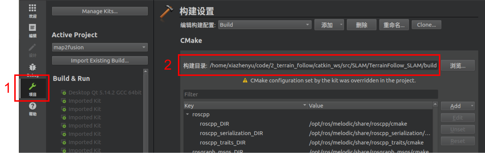

# QtCreator

## 使用qtcreator打开已有的项目

有时qtcreator和终端设置的系统变量并不一样，所以qtcreator去进行cmake可能会失败，可以通过以下方式进行编译：

​	在终端中创建build文件夹，并且在里面执行cmake与make成功之后，在终端输入命令qtcreator CMakeLists.txt

​	然后进入如下界面：

​	先点击项目，然后在构建目录选择此工程的build文件夹，这样就可以让qtcreator去自动寻找本项目配置好的环境变量。

## 参考

* [QtCreator快速入门](https://blog.csdn.net/sinat_27554409/article/details/78171499)