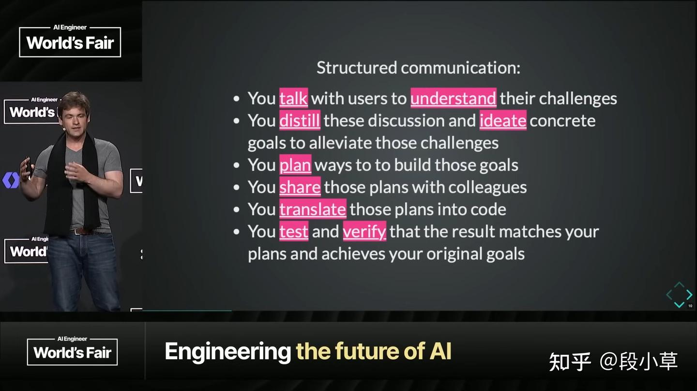
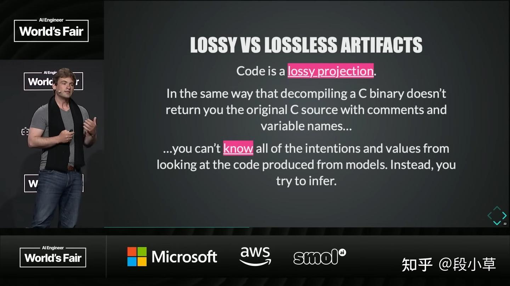
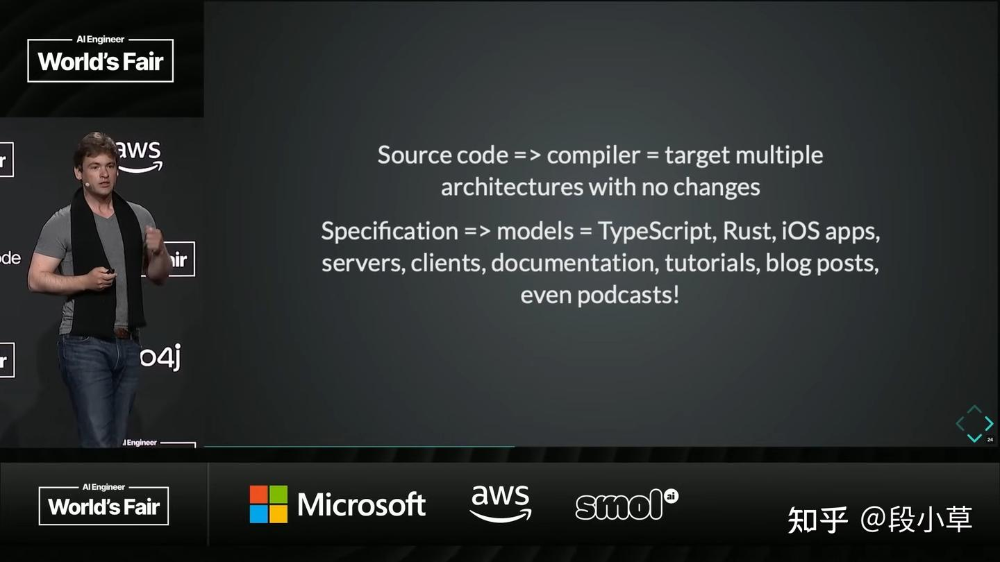
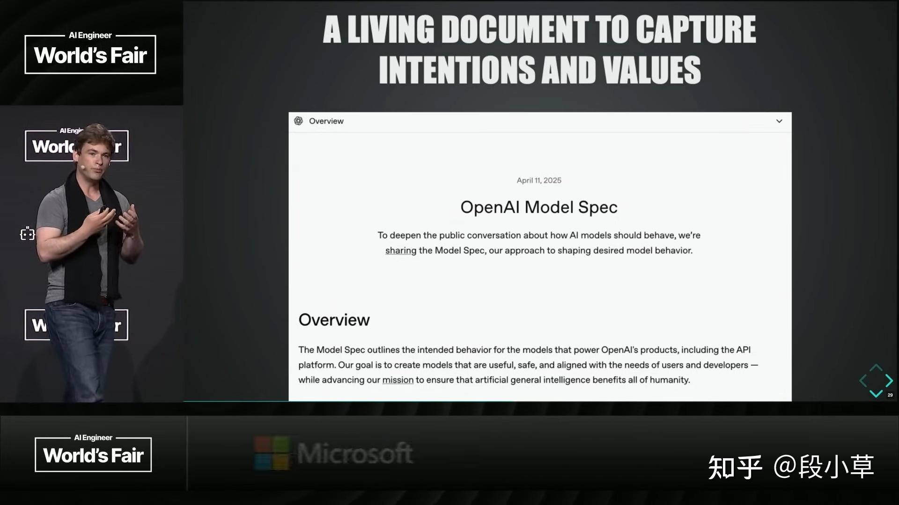

# AI 编程新范式

我们正迎来「新代码」时代，而这份「新代码」，不是你我熟知的程序语言，而是 **「规范」（Specification，下文简称 Spec）**。Sean 认为，编写一份严谨、可版本化、可执行的 Spec，将成为未来程序员乃至所有知识工作者的「新超能力」。这份 Spec 将作为唯一的「真理之源」（source of truth），最终编译成文档、评估、模型行为，乃至代码本身。

在 AI 时代，Spec 能真正做到「一次编写，处处运行」。这不仅仅是一个理论。从 OpenAI 内部的 `Model Spec`，到亚马逊最新发布的 AI IDE `Kiro`，整个行业似乎都在验证同一个趋势：**软件工程正在回归其本质——沟通**。

## **重新定义程序员的价值：你 80% 的工作，其实是「结构化沟通」**

如果你是一名程序员，你认为自己产出的最有价值的专业成果是代码吗？

很多人会下意识地点头。毕竟，我们花费无数心血与用户沟通、梳理需求、设计实现、集成系统，最终的产物就是那一行行坚实的代码。代码是我们可以指向、衡量、辩论和讨论的实体，感觉具体而真实。

但 Sean 指出，这其实低估了你的价值。代码，可能只占你创造价值的 10% 到 20%。另外 80% 到 90% 的价值，在于 **「结构化沟通」（structured communication）**。

仔细回想一下我们的工作流程：

1. **沟通与理解**：与用户交谈，理解他们的挑战。
2. **提炼与构思**：将故事提炼，构思如何解决这些问题，明确目标。
3. **规划与分享**：规划实现目标的路径，并与同事分享。
4. **翻译为代码**：这是重要的一步，但只是其中一步。
5. **测试与验证**：你真正在乎的不是代码本身，而是代码运行后 **是否达成了最初的目标**，是否解决了用户的痛点。

看，交谈、理解、提炼、构思、规划、分享、翻译、测试、验证——这些听起来都像是「结构化沟通」。而这，正是整个软件开发流程中的 **核心瓶颈**：

- 知道 **该构建什么** (What to build)
- 知道 **如何构建** (How to build it)
- 知道 **为何构建** (Why to build it)
- 最终，知道 **构建得是否正确** (If it has been built correctly)

随着 AI 模型变得越来越强大，我们每个人都将更加尖锐地感受到这个瓶颈。

Sean 预言：在不远的将来，**能够最有效沟通的人，就是最有价值的程序员**。甚至可以说，**如果你能有效沟通，你就能编程**。

以时下流行的「[Vibe Coding](https://zhida.zhihu.com/search?content_id=260483796&content_type=Article&match_order=1&q=Vibe+Coding&zhida_source=entity)」为例。我们通过 `prompt` 与模型沟通，描述我们的意图和期望的结果，让模型处理繁重的工作。这个过程感觉很好，因为它本质上是「沟通优先」的，代码只是沟通的下游产物。

但这里存在一个悖论：我们煞费苦心地写下 `prompt`，其中包含了我们所有的意图和价值观，然后得到了代码。最后，我们却随手丢弃了那些 `prompt`。

Sean 的比喻一针见血：**这感觉就像你把源代码撕得粉碎，然后小心翼翼地对编译后的二进制文件进行版本控制**。

在传统的软件开发中，源代码才是最有价值的资产，是我们可以不断编译、生成新版本的「真理之源」。但在与 LLM 的交互中，我们却反其道而行之：**保留了生成物（代码），删除了规约（prompt）**。

这正是为什么将意图和价值观固化在 **一份书面化的 Spec** 中如此重要。

## **The New Code：一份好的 Spec，胜过万行代码**

一份书写的 Spec，究竟有什么魔力？

它的核心价值在于，**它能够让所有人类（产品、研发、法务、安全等）在一个共同的目标集上对齐**。它是你们讨论、辩论、参考和同步的唯一依据。没有 Spec，你们拥有的只是一个模糊的想法。

为什么说 Spec 比代码本身更强大？因为代码本身就是 Spec 的一种 **「有损投影」（lossy projection）**。

想象一下，你将一个编译好的 C 语言二进制文件反编译，你不会得到清晰的注释和语义化的变量名。你必须反向推断：「作者当初想做什么？这段代码为什么要这么写？」**所有的意图和背景故事，在编译过程中丢失了**。

同样，**即使是写得很好的代码，通常也无法完全体现其背后的所有意图和价值观**。当你阅读代码时，你仍然需要去推断团队想要实现的最终目标。

而一份好的 Spec，一份蕴含了所有沟通成果的书面规范，它 **编码了生成代码所需的所有必要需求**。

这就像拥有可以编译到不同目标架构的源代码一样。一份源码可以编译成 ARM64、x86 或 WebAssembly 版本。同样地，**一份足够强大的 Spec，在 AI 的辅助下，可以「编译」成优质的 TypeScript、Rust、服务器、客户端、文档、教程、博客文章，甚至播客**。

因此，未来的稀缺技能，是 **撰写能够完全捕捉意图和价值观的 Spec**。掌握它的人，将成为最有价值的程序员。

这个角色可能是今天的程序员，也可能是产品经理，甚至是法务人员。这是一个通用原则。 **「Specification Engineering」（规范工程）**，或者说 **「Specification Design」（规范设计）**，正在成为新的风口。

## **OpenAI 的 `Model Spec`**

为了让这个概念更具体，Sean 详细介绍了 OpenAI 内部的实践——`Model Spec`。

`Model Spec` 是一个活的文档，它试图清晰、无歧义地表达 OpenAI 希望为其模型注入的意图和价值观。去年发布，今年 2 月更新并完全开源。

当你访问其 GitHub 仓库时，你会惊讶地发现，它实际上就是 **一堆 Markdown 文件**。

Markdown 这种格式非常了不起。它人类可读、可版本化、有变更日志。由于它是自然语言，**公司内部的每个人——不仅仅是技术人员，还包括产品、法务、安全、研究和政策团队——都可以阅读、讨论、辩论并为同一个「源代码」做出贡献**。

这份 Spec，成为了在 OpenAI 内部对齐所有人类关于模型意图和价值观的通用工件。

当然，自然语言难免有歧义。为了解决这个问题，`Model Spec` 中的每一条条款都有一个唯一的 ID，例如 `SY-73`。通过这个 ID，你可以在仓库中找到一个对应的文件 `SY-73.md`，其中包含一个或多个针对该条款的、极具挑战性的 `prompt`。

这意味着，**Spec 文档本身就编码了成功标准**，被测试的模型必须能够以遵循该条款的方式回答这些 `prompt`。

## References

* https://zhuanlan.zhihu.com/p/1929225732837585807 OpenAI 员工揭秘 AI 编程新范式：提示词工程已死，未来属于「规范工程师」
* https://github.com/openai/model_spec The OpenAI Model Spec
* 万字长文｜OpenAI模型规范（全文） https://zhuanlan.zhihu.com/p/702411697
