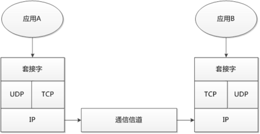
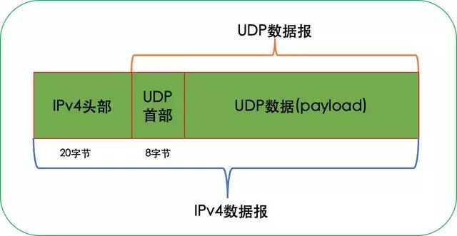
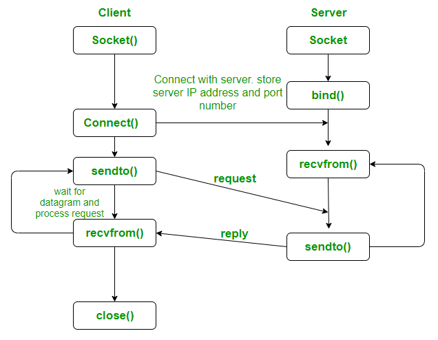

## UDP学习使用笔记

该笔记主要服务于通过UDP通讯协议发布MAVLink指令，以此达到控制无人机的效果。

里面的内容主要与[code_cook里面的socket++程序](https://gitee.com/pi-lab/code_cook/tree/master/network/socket++)相关。(原程序是通过TCP协议发送信息的)

相关程序可以从google上面查询**UDP SAMPLE CODE**或**ASIO**，前者是UDP通讯协议发送和接收的基本方法和流程，后面是一个与网络通讯的大网站，可以在里面查询代码。

### 一. 什么是UDP？

UDP是User Datagram Protocol(用户数据报协议)的缩写，它是一个简单的协议，简单到UDP规范RFC0768只有区区3页。

UDP是工作在IP层之上的传输层协议，UDP对IP主要有两个扩展：

1. 扩展出端口号使得IP数据报可以多路分发到用户进程。

2. 扩展出校验和提供网络传输过程中数据差错的检验。

IP提供了一种尽力而为、无连接的数据报交付服务。IP基于IP地址实现路由和分组转发，可以将一个IP数据报从网络的一台主机传送到另一台主机，IP地址决定IP数据报将被送往哪个主机。所以，IP提供主机到主机的数据报传输服务。

IP数据报到达目的主机后，内核层实现的IP模块，会负责接收网卡上的IP数据报，但主机上通常会同时运行多个进程，IP数据报应该交给哪个进程去处理呢？IP搞不定。

端口号(位于UDP首部)决定数据报交给主机上的哪个进程处理。所以，UDP为端主机上运行的应用程序提供了端到端服务。



### 二. UDP数据报封装格式

IPv4协议(Protocol)字段用值17来标识UDP，UDP数据报头部通常是8字节，IPv4头部之后紧接着是UDP头部，然后是UDP数据Payload(如有)。




### 三. UDP编程通讯逻辑

要想用C++编成实现UDP服务端和客户端的创建，需要用到一些列函数，这些函数被封装在
UDP通讯程序运行逻辑如图所示：



下面简单介绍一下里面所用的函数和数据类型

#### 1.socket函数

用来创建套接字，这个是UDP通讯协议的核心，不论是创建UDP服务器还是UDP客户端都必须要先创建套接字。

套接字是TCP/UDP通讯协议的关键，是发送和接收讯息的前提。

```
int socket(int domain, int type, int protocol)  
```

- domain：指明了协议族/域，通常 AF_INET, AF_INET6, AF_LOCAL;(一般都选AF_INET)
- type：套接口类型，主要 SOCK_STREAM(TCP), SOCK_DGRAM(UDP), SOCK_RAW(原始socket);（根据需要选择，看看选用什么通讯协议）
- protocol：一般取为0。成功时，返回一个小的非负整数值，与文件描述符类似;
- return：成功0; 失败-1;（可以通过这个来判断是否成功生成套接字）

#### 2.bind函数

bind 功能是把一个本地协议地址赋予一个套接字，告知内核去选择该IP地址。该函数用于服务端。

```
int bind(int sockfd, const struct sockaddr* my_addr, socklen_t addrlen);  
```

- sockfd: 套接字实例;(前面用socket函数创建)
- my_addr：指向 sockaddr 结构体类型的指针;（一般自己创建sockaddr_in数据类型，但是在bind函数中会强制转换他的数据类型为sockaddr，两者关系在后续会说明）
- addrlen：表示 my_addr 结构的长度，用 sizeof 操作符获取;
- return：成功0; 失败-1;

#### 3.sockaddr_in和sockaddr数据类型

sockaddr_in：sockaddr_in是用于IPv4地址的结构体，定义如下：

```
struct sockaddr_in {
    short int sin_family;        // 地址族（一般为 AF_INET）
    unsigned short int sin_port; // 端口号
    struct in_addr sin_addr;     // IPv4 地址
    unsigned char sin_zero[8];   // 无意义字段（通常填充0）
};
```
其中，sin_family表示地址族，一般为AF_INET，表示IPv4地址。sin_port表示端口号，sin_addr表示IPv4地址，sin_zero是一个无意义的字段，通常填充0。

sockaddr：sockaddr是一个通用的地址结构体，用于表示各种类型的套接字地址，定义如下：

```
struct sockaddr {
    unsigned short sa_family;    // 地址族
    char sa_data[14];            // 地址信息
};
```

**一般在定义地址信息的时候使用sockaddr_in结构体，但是考虑到某些函数输入参数的要求（eg:bind()）,所以经常把sockaddr_in数据转换为sockaddr数据((struct sockaddr\*))**

#### 4.connect

connect 功能是用于建立与指定socket的连接,该函数用于客户端。

```
int connect(int soctfd, const struct sockaddr * addr, int addrlen);  
```

- soctfd：标识一个未连接socket;
- addr：指向要连接套接字的sockaddr结构体的指针;(一般需要从定义的sockaddr_in转换过来)
- addrlen：sockaddr结构体的字节长度，用 sizeof 操作符获取;
- return：成功0; 失败-1;
- a. 硬错：端口号错误，服务器进程未开启，收到RST，立刻返回ECONNREFUSED;
- b. 软错：IP不可达，协议ICMP，比如 no route to host，通常是发送arp请求无响应;

#### 5.sendto

发送消息字

```
ssize_t sendto(int sockfd, const void *buf, size_t len, int flags,
			   const struct sockaddr *dest_addr, socklen_t addrlen);
```

- sockfd: 正在监听端口的套接口实例;
- buf：要发送的数组(先前定义好的);
- len: 要发送的数组的字节大小;
- flags: 填0即可;
- dest_addr: 指定数据要发送到哪个主机，哪个进程（需要转换形式）;
- addrlen: 表示 dest_addr 所指向内容的长度;
- return：成功: 数据长度; 失败: -1;

tips：可以通过成功返还的数据长度进行高级操作。

#### 6.recvfrom

接收消息字

```
ssize_t recvfrom(int sockfd, void *buf, size_t len, int flags,
                 struct sockaddr *src_addr, socklen_t *addrlen);  
```

- sockfd: 正在监听端口的套接口实例;
- buf: 要接收的数组;
- len: 要接收的数组的字节大小;
- flags: 填0即可;
- src_addr: 获取接收的数据是从哪个主机地址发来的;
- addrlen: 表示 src_addr 所指向内容的长度;
- return: 成功: 数据长度; 失败: -1;

tips：可以通过成功返还的数据长度进行高级操作。

#### 7.小工具
 
```
// 打印ip和port
std::printf("接收到一个连接, 其ip: %s, port: %d\n", inet_ntoa(m_RemoteAddress.sin_addr), ntohs(m_RemoteAddress.sin_port));
```

```
// 将ip转格式到sin_addr
inet_pton(AF_INET, ip, &m_RemoteAddress.sin_addr);  
```

#### 结语

通过上面简单UDP编程逻辑介绍和常用函数介绍，基本可以理解UDP的通讯原理和逻辑，如果想要进一步了解对UDP通讯的编程的应用可以参考[code_cook里面的socket++程序](https://gitee.com/pi-lab/code_cook/tree/master/network/socket++)，这个程序实现了tcp、udp的发送与接收。

##### Reference
[【C++开发UDP通信：使用socket创建UDP服务器端和客户端】](https://blog.csdn.net/weixin_41275726/article/details/124529812?ops_request_misc=&request_id=&biz_id=102&utm_term=%E7%94%A8C++%E7%BC%96%E6%88%90%E5%AE%9E%E7%8E%B0UDP%E5%AE%A2%E6%88%B7%E7%AB%AF%E5%92%8C%E6%9C%8D%E5%8A%A1%E7%AB%AF&utm_medium=distribute.pc_search_result.none-task-blog-2~all~sobaiduweb~default-1-124529812.142^v99^pc_search_result_base9&spm=1018.2226.3001.4187)
[【UDP Client Server using connect | C implementation】](https://www.geeksforgeeks.org/udp-client-server-using-connect-c-implementation/)
[【UDP SAMPLE CODE】](https://groups.seas.harvard.edu/courses/cs143/pa-one/client-server.html)