##  TCP/IP协议

* 计算机网络的层次结构（OSI模型）
  * 应用层：为计算机用户提供接口和服务应用层协议，包括HTTP（万维网服务）、FTP（文件传输）、SMTP（电子邮件）、SSH（安全远程登陆）、DNS（域名解析）
  * 表示层：数据处理（编码解码、加密解密等）
  * 会话层：管理（建立、维护、重连）通信会话
  * 传输层：管理端到端的通信连接
  * 网络层：数据路由（计算数据在网络的路径）
  * 数据链路层：管理相邻节点之间的数据通信
  * 物理层：数据通信的光电物理特性

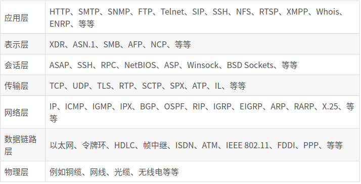

* TCP/IP分层（简化过后的OSI模型）
  * 网络接口层：Ethernet 
  * 网络层：IP
  * 运输层：TCP、UDP
  * 应用层：HTTP、FTP、SMTP

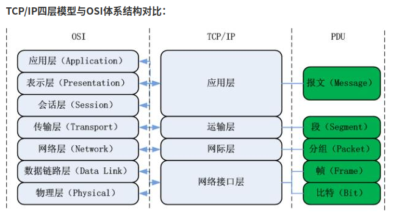

#### HTTP报文传输过程

利用TCP/IP进行网络通信时，数据包会按照分层顺序与对方进行通信。发送端从应用层往下走，接收端从链路层往上走。从客户端到服务器的数据，每一帧数据的传输的顺序都为：应用层->运输层->网络层->链路层->链路层->网络层->运输层->应用层。

以一个HTTP请求的传输为例，请求从HTTP客户端（如浏览器）和HTTP服务端应用的传输过程，大致如下图所示：

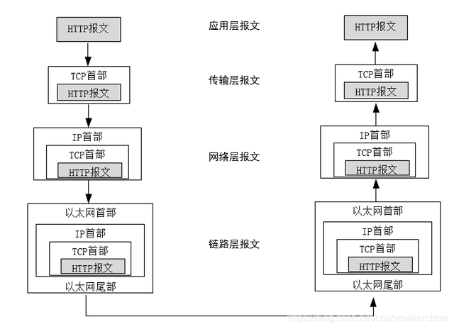

数据通过互联网传输的时候不可能是光秃秃的不加标识，如果这样数据就会乱。所以数据在发送的时候，需要加上特定标识，加上特定标识的过程叫做数据的封装，在数据使用的时候再去掉特定标识，去掉特定标识的过程就叫做分用。TCP/IP协议的数据封装和分用过程，大致如下图所示：

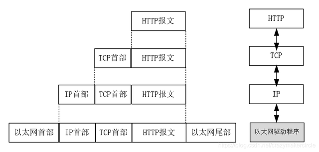

### 通信的原始时代

很久很久之前，你不与任何其他电脑相连接，孤苦伶仃。

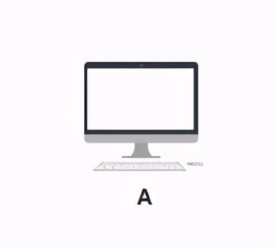

直到有一天，你希望与另一台电脑 B 建立通信，于是你们各开了一个网口，用一根**网线**连接了起来。

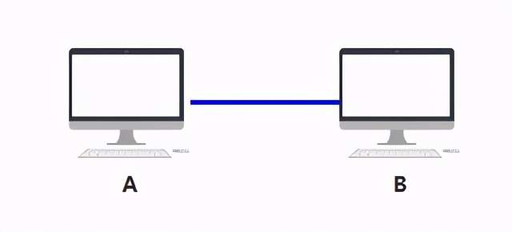

有一天，一个新伙伴 C 加入了，但聪明的你们很快发现，可以每个人开**两个网口**，用一共**三根网线**，彼此相连。

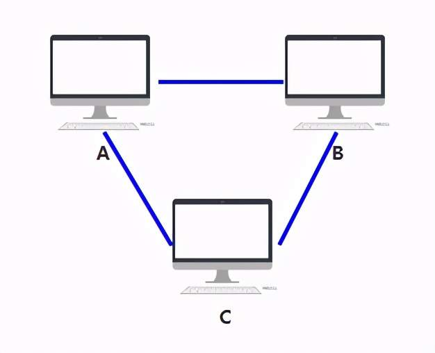

随着越来越多的人加入，你发现身上开的网口实在太多了，而且网线密密麻麻，混乱不堪。（而实际上一台电脑根本开不了这么多网口，所以这种连线只在理论上可行，所以连不上的就用红色虚线表示了）

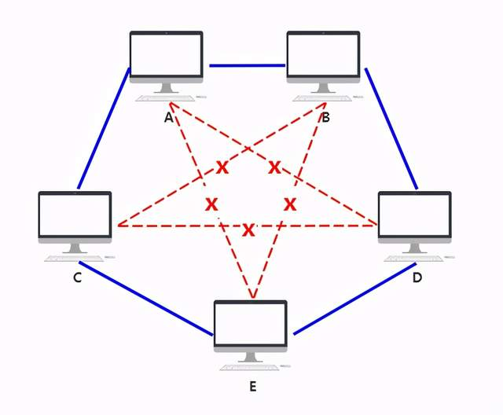

### 集线器的诞生

于是你们发明了一个中间设备，你们将网线都插到这个设备上，由这个设备做转发，就可以彼此之间通信了，本质上和原来一样，只不过网口的数量和网线的数量减少了，不再那么混乱。

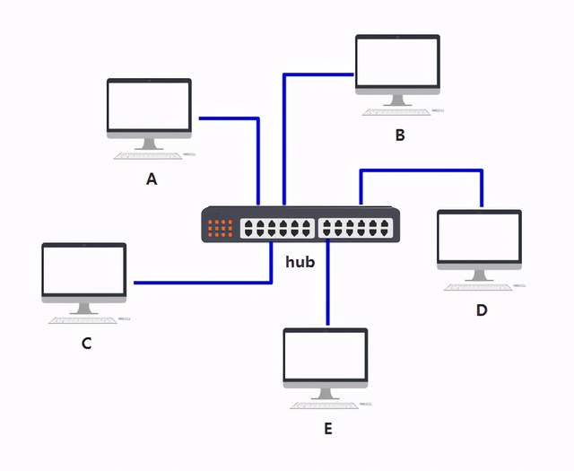

你给它取名叫**集线器**，它仅仅是无脑将电信号**转发到所有出口（广播）**，不做任何处理，你觉得它是没有智商的，因此把人家定性在了**物理层**。

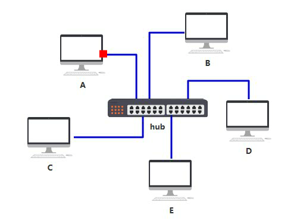

由于转发到了所有出口，那 BCDE 四台机器怎么知道数据包是不是发给自己的呢？

首先，你要给所有的连接到交换机的设备，都起个名字。原来你们叫 ABCD，但现在需要一个更专业的，全局唯一的名字作为标识，你把这个更高端的名字称为 MAC 地址。

你的 MAC 地址是 aa-aa-aa-aa-aa-aa，你的伙伴 b 的 MAC 地址是 bb-bb-bb-bb-bb-bb，以此类推，不重复就好。

这样，A 在发送数据包给 B 时，只要在头部拼接一个这样结构的数据，就可以了。

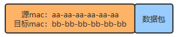

B 在收到数据包后，根据头部的目标 MAC 地址信息，判断这个数据包的确是发给自己的，于是便**收下**。

其他的 CDE 收到数据包后，根据头部的目标 MAC 地址信息，判断这个数据包并不是发给自己的，于是便**丢弃**。

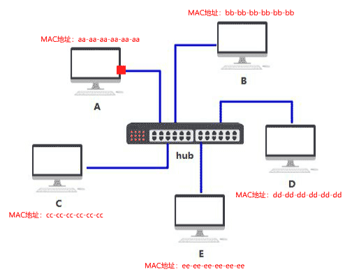

虽然集线器使整个布局干净不少，但原来我只要发给电脑 B 的消息，现在却要发给连接到集线器中的所有电脑，这样既不安全，又不节省网络资源。

### 集线器的问题

如果把这个集线器弄得更智能一些，**只发给目标 MAC 地址指向的那台电脑**，就好了。

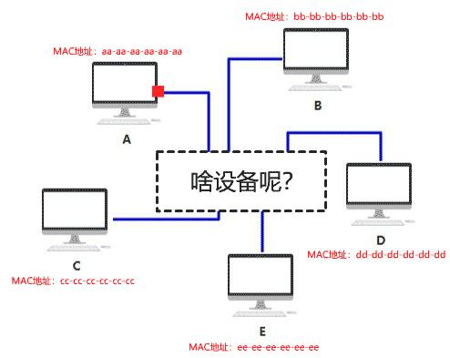

### 交换机的诞生

虽然只比集线器多了这一点点区别，但看起来似乎有智能了，你把这东西叫做**交换机**。也正因为这一点点智能，你把它放在了另一个层级，**数据链路层**。

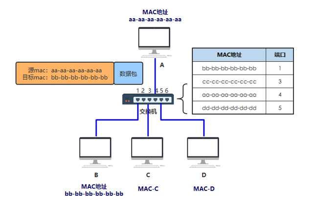

交换机内部维护一张 **MAC 地址表**，记录着每一个 MAC 地址的设备，连接在其哪一个端口上。

通过这样传输方式而组成的小范围的网络，叫做**以太网**。

当然最开始的时候，MAC 地址表是空的，是怎么逐步建立起来的呢？

过程如下

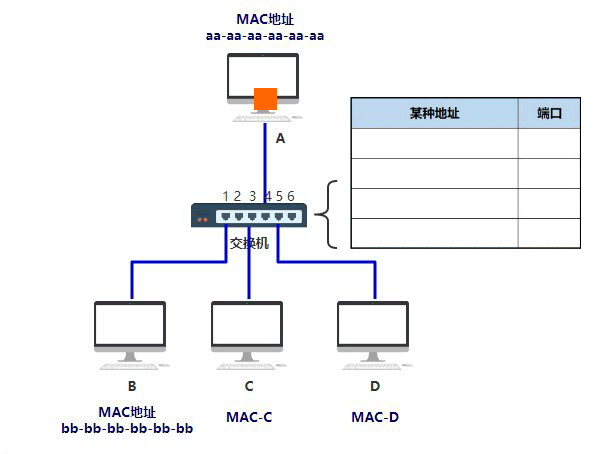

### IP地址和路由器

电脑的数量越来越多，交换机已经无法记录如此庞大的映射关系了。

接入一个**新的设备**，这个设备就跟电脑一样有自己独立的 MAC 地址，而且同时还能帮我把数据包做一次**转发**呢？

这个设备就是**路由器，**它的功能就是，作为一台独立的拥有 MAC 地址的设备，并且可以帮我把数据包做一次转发**，**你把它定在了**网络层。**

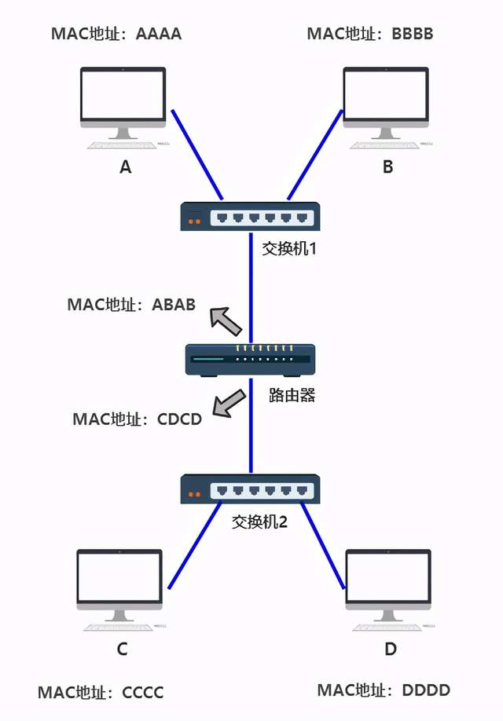

（注意，路由器的每一个端口，都有独立的 MAC 地址）

那如何做到，把发送给 C 和或D的数据包，统统先发送给路由器呢？即路由器怎么把目标一致的进行整合？

于是你发明了一个新的地址，给每一台机器一个 32 位的编号，如：

**11000000101010000000000000000001**

你觉得有些不清晰，于是把它分成四个部分，中间用点相连。

**11000000.10101000.00000000.00000001**

你还觉得不清晰，于是把它转换成 10 进制。

**192.168.0.1**

最后你给了这个地址一个响亮的名字，**IP 地址**。现在每一台电脑，同时有自己的 MAC 地址，又有自己的 IP 地址，只不过 IP 地址是**软件层面**上的，可以随时修改，MAC 地址一般是无法修改的。

这样一个可以随时修改的 IP 地址，就可以根据你规划的网络拓扑结构，来调整了。

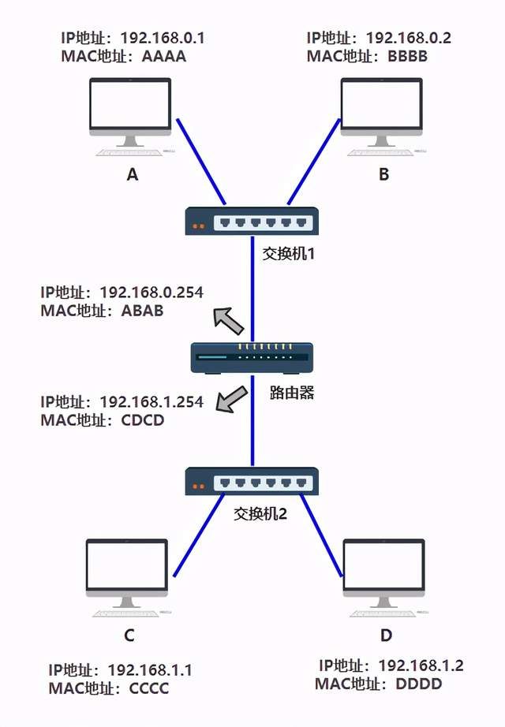

现在两个设备之间传输，除了加上数据链路层的头部之外，还要再增加一个网络层的头部。

假如 A 给 B 发送数据，由于它们直接连着交换机，所以 A 直接发出如下数据包即可，其实网络层没有体现出作用。

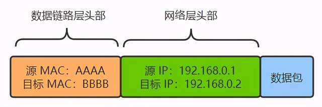

但假如 A 给 C 发送数据，A 就需要先转交给路由器，然后再由路由器转交给 C。由于最底层的传输仍然需要依赖以太网，所以数据包是分成两段的。

A ~ 路由器这段的包如下：

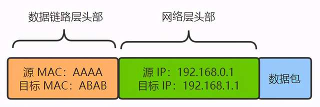

路由器到 C 这段的包如下：

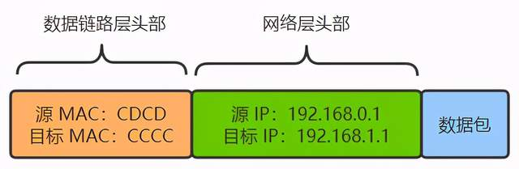

如果源 IP 与目的 IP 处于一个子网，直接将包通过交换机发出去。

如果源 IP 与目的 IP 不处于一个子网，就交给路由器去处理。

**什么叫处于一个子网?**

- 192.168.0.1 和 192.168.0.2 处于同一个子网
- 192.168.0.1 和 192.168.1.1 处于不同子网

假如某台机器的子网掩码定为 255.255.255.0

这表示，将源 IP 与目的 IP 分别同这个子网掩码进行**与运算，相等则是在一个子网，不相等就是在不同子网**，就这么简单。

* A电脑：192.168.0.1 & 255.255.255.0 = 192.168.0.0
* B电脑：192.168.0.2 & 255.255.255.0 = 192.168.0.0
* C电脑：192.168.1.1 & 255.255.255.0 = 192.168.1.0
* D电脑：192.168.1.2 & 255.255.255.0 = 192.168.1.0

所以如果 A 给 C 发消息，A 和 C 的 IP 地址分别 & A 机器配置的子网掩码，发现不相等，则 A 认为 C 和自己不在同一个子网，于是把包发给路由器，就不管了，**之后怎么转发，A 不关心**。

**A 如何知道，哪个设备是路由器？**

**答案：在 A 上要设置默认网关**

**默认网关，就是 A 在自己电脑里配置的一个 IP 地址**，以便在发给不同子网的机器时，发给这个 IP 地址。

路由器收到的数据包有目的 IP 也就是 C 的 IP 地址，需要转化成从自己的哪个端口出去，很容易想到，应该有个表，就像 MAC 地址表一样。

这个表就叫**路由表**。

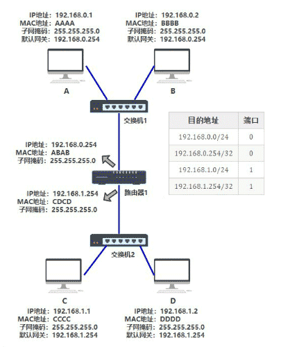

在网络层，**我需要把 IP 地址对应的 MAC 地址找到**，也就是通过某种方式，找到 **192.168.0.2** 对应的 MAC 地址 **BBBB**。

这种方式就是 **arp 协议**，同时电脑 A 和 B 里面也会有一张 **arp 缓存表**，表中记录着 **IP 与 MAC 地址**的对应关系。

| IP 地址     | MAC 地址 |
| ----------- | -------- |
| 192.168.0.2 | BBBB     |

一开始的时候这个表是**空的**，电脑 A 为了知道电脑 B（192.168.0.2）的 MAC 地址，将会**广播**一条 arp 请求，B 收到请求后，带上自己的 MAC 地址给 A 一个**响应**。此时 A 便更新了自己的 arp 表。

这样通过大家不断广播 arp 请求，最终所有电脑里面都将 arp 缓存表更新完整。

## 5.4.1 传输层

* 第一个端到端，即主机到主机的层次。传输层负责将上层数据分段并提供端到端的、可靠的或不可靠的传输。此外，传输层还要处理端到端的差错控制和流量控制
* 传输层的任务是根据通信子网的特性，最佳的利用网络资源，为两个断系统的会话层之间，提供建立、维护和取消传输连接的功能，负责端到端的可靠数据传输。在这一层，信息传送的协议数据单元称为段或报文
* 网络层只是根据网络地址将源节点发出的数据包传送到目的结点，而传输层则负责将数据可靠地传送到相应的端口。
* 包含的主要协议：TCP协议（Transmission Control Protocol，传输控制协议），UDP协议（User Datagram Protocol，用户数据报协议）
* 重要设备：网关
* TCP协议是一个面向连接的、可靠的传输协议，它提供一种可靠的字节流，能保证数据完整、无损并且按顺序到达。TCP尽量连续不断地测试网络的负载并且控制发送数据的速度以避免网络过载。另外，TCP试图将数据按照规定的顺序发送。(比如发送邮件)
  
* UDP协议是一个无连接的数据报协议，是一个“尽力传递”和“不可靠”协议，不会对数据包是否已经到达目的地进行检查，并且不保证数据包按顺序到达。（比如发送视频）

​	总体来说，TCP协议传输效率低，但可靠性强；UDP协议传输效率高，但可靠性略低，适用于传输可靠性要求不高、体量小的数据。

* TCP协议的报文格式

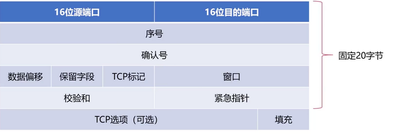

* 源端口号：报文的发送端口
* 目的端口：报文的接收端口

* 序号字段：TCP的序号是对每个数据的每个字节进行编号
* 确认序号字段：期望从对方接收数据的字节序号，即该序号对应的字节尚未收到，用ack_seq标识

* TCP标识的含义

  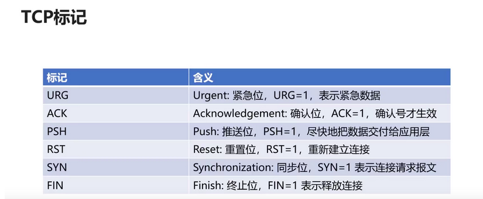

  若只是单个SYN置位，表示的只是建立连接请求。如果SYN和ACK同时置位为1，表示的建立连接之后的响应。

  

* TCP可靠传输工作原理

  TCP连接的端点叫做socket，套接字socket=（IP地址：端口号）

  * 不可靠传输信道在数据传输中可能发生的情况：比特差错、乱序、重传、丢失
  * 基于不可靠信道实现可靠数据传输采取的措施：
    * 差错检测：利用编码实现数据包传输过程中的比特差错检测
    * 确认：接受方向发送方反馈接收状态
    * 重传：发送方重新发送接收方没有正确接受的数据
    * 序号：确保数据按序提交
    * 计时器：解决数据丢失的问题

* TCP连接的三次握手：建立连接 

  * 第一次握手：客户发送请求，此时服务器知道客户能发，自己能收

    **客户向服务器发送连接请求段**，建立连接请求控制段（SYN=1）,表示传输的报文段的第一个数据字节的序列号是x，此序列号代表整个报文段的序号（seq=x），客户端进行**SYN_SEND （同步发送状态）**

  * 第二次握手：服务器发送确认，此时客户知道服务器能发能收，自己能发能收

    服务器发回确认报文段，同意建立新连接的确认段（SYN=1）,确认序号字段有效（ACK=1）,服务器告诉客户端报文段序号是y（seq=y）,表示服务器已经收到客户端序号为x的报文段，准备接受客户端序列号为x+1的报文段（seq=x+1）,**服务器由LISTEN进入SYN_RCVD （同步收到状态）**

  * 第三次握手：客户发送确认，此时服务器知道客户能发能收，自己能发能收

    **客户对服务器的同一连接进行确认**，确认序号字段有效（ACK=1）,客户此次的报文段的序列号是x+1（seq=x+1）,客户期望接受服务器序列号为y+1的报文段（ack_seq=y+1），当客户发送ack数据时，客户端进入**ESTABLISHED**状态；当服务收到客户发送的ack后，也进入**ESTABLISHED**状态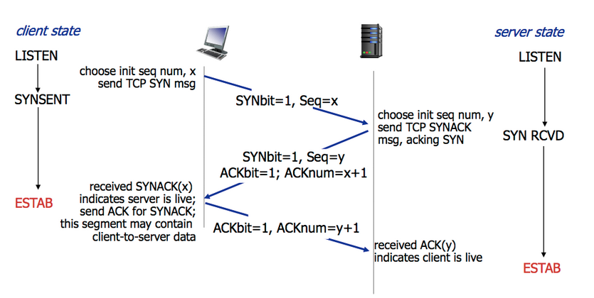

* TCP连接的四次挥手：释放连接

  * 第一次（客户端：我要关闭）

    **客户向服务器发送释放连接报文段**，发送端数据发送完毕，请求释放连接（FIN=1）,传输的第一个数据字节的序号是x（seq=x）；**客户端状态由ESTABLISHED进入FIN_WAIT_1(终止等待1状态)**

  * 第二次（服务端：还有数据没传完，传完给你说）

    **服务器向客户端发送确认段**，正常情况下，在收到了主动断开方发送的FIN断开请求报文后，被动断开方会发送一个ACK响应报文，报文的Acknowledgment Number（确认号）值为断开请求报文的Sequence Number（序列号）加1，该ACK确认报文的含义是：“我同意你的连接断开请求”。之后，被动断开方就进入了CLOSE-WAIT（关闭等待）状态，TCP协议服务会通知高层的应用进程，对方向本地方向的连接已经关闭，对方已经没有数据要发送了，若本地还要发送数据给对方，对方依然会接受。被动断开方的CLOSE-WAIT（关闭等待）还要持续一段时间
    主动断开方在收到了ACK报文后，由FIN_WAIT_1转换成FIN_WAIT_2状态。

  * 第三次（服务端：我传完了，请求关闭）

    **服务器向客户发送释放连接报文段**，请在发送完成ACK报文后，被动断开方还可以继续完成业务数据的发送，待剩余数据发送完成后，或者CLOSE-WAIT（关闭等待）截止后，被动断开方会向主动断开方发送一个FIN+ACK结束响应报文，表示被动断开方的数据都发送完了，然后，被动断开方进入LAST_ACK状态。

  * 第四次（客户端：可以，你关吧）

    主动断开方收在到FIN+ACK断开响应报文后，还需要进行最后的确认，向被动断开方发送一个ACK确认报文，然后，自己就进入TIME_WAIT状态，等待超时后最终关闭连接。处于TIME_WAIT状态的主动断开方，在等待完成2MSL的时间后，如果期间没有收到其他报文，则证明对方已正常关闭，主动断开方的连接最终关闭。

  * 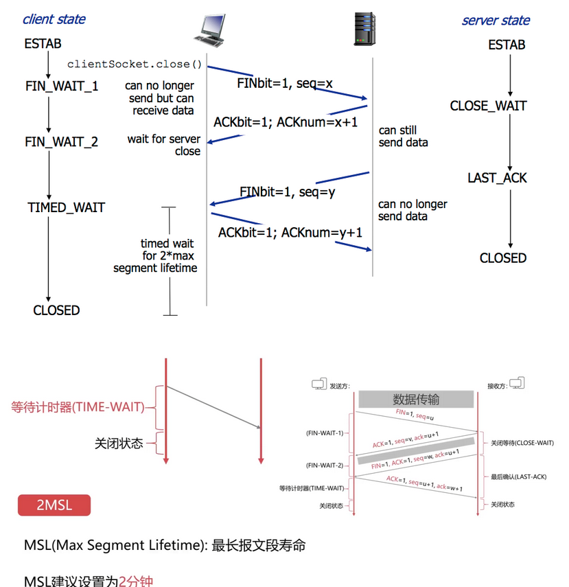

为什么需要等待2MSL？

1. 最后一个报文没有确认

2. 确保发送方的ACK可以到达接收方

3. 2MSL时间内没有收到，则接受方会重发

4. 确保当前连接的所有报文都已经过期

   

references:[太棒了！TCP/IP协议 （图解+秒懂+史上最全）](https://blog.csdn.net/stone_tmp/article/details/118386484?ops_request_misc=%257B%2522request%255Fid%2522%253A%2522168161798516800184198353%2522%252C%2522scm%2522%253A%252220140713.130102334..%2522%257D&amp;request_id=168161798516800184198353&amp;biz_id=0&amp;utm_medium=distribute.pc_search_result.none-task-blog-2~all~top_positive~default-1-118386484-null-null.142^v83^control,239^v2^insert_chatgpt&amp;utm_term=TCP%2FIP&amp;spm=1018.2226.3001.4187#t25)
