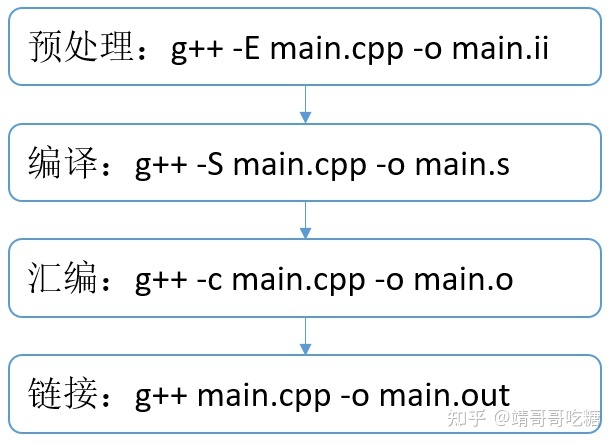

# Ｃ／C++程序编译过程

**C+ +语言支持“分别编译”（separate compilation）：**
 一个程序所有的内容，可以分成不同的部分分别放在不同的.cpp文件里。
 **.cpp文件里的东西都是相对独立的，在编译（compile）时不需要与其他文件互通，只需要在编译成目标文件后再与其他的目标文件做一次链接（link）就行了。**

高级语言分三类：**编译型**、**解释型**、**混合型**，都必须编译成机器指令才能执行。**C/C++属于编译型，程序要能够执行，必须要有编译器和链接器支持。**

编译过程主要分为4个过程    

1. 编译预处理      

2. 编译、优化阶段       

3. 汇编过程       

4. 链接程序

   

```text
-E：只完成预处理工作，停止编译、汇编、链接；
    g++生成的文件后缀名为.ii，gcc生成的文件后缀名为.i。
-S：只完成到编译步骤，停止汇编和链接；
    注意这里是大写的-S，小写的-s是一个链接参数，用来删除符号表，压缩可执行文件大小。
-c：只完成到汇编步骤，不进行链接；
    默认情况下，gcc会将单参的printf替换成puts以提高运行速度，可以通过-fno-builtin关闭内置函数优化。
-o：指定输出文件；
    注意这里是小写的-o，大写的-O是一个链接参数，用来指定编译优化等级。
```

可以保留编译产生的中间文件

```
# gcc --help |grep save-temps
-save-temps         Do not delete intermediate files.
-save-temps=<arg>   Do not delete intermediate files.
```


## 一、编译预处理

（1）**宏定义指令**，如#define Name TokenString，#undef等。 对于前一个伪指令，预编译所要做的是将程序中的所有Name用TokenString替换，

但作为字符串常量的 Name则不被替换。对于后者，则将取消对某个宏的定义，使以后该串的出现不再被替换。

（2）**条件编译指令，**如#ifdef，#ifndef，#else，#elif，#endif等。 这些伪指令的引入使得程序员可以通过定义不同的宏来决定编译程序对哪些代码进行处理。

预编译程序将根据有关的文件，将那些不必要的代码过滤掉

（3） **头文件包含指令**，如#include "FileName"或者#include <FileName>等。 在头文件中一般用伪指令#define定义了大量的宏（最常见的是字符常量），**删除#include xxx，将include的头文件包含进来.**

同时包含有各种外部符号的声明。 包含到c源程序中的头文件可以是系统提供的，这些头文件一般被放在/usr/include目录下。在程序中#include它们要使用尖括号（< >）。

另外开发人员也可以定义自己的头文件，这些文件一般与c源程序放在同一目录下，此时在#include中要用双引号（""）。

（4）**特殊符号，**预编译程序可以识别一些特殊的符号。 例如在源程序中出现的#line标识将被解释为当前行号（十进制数），  上面程序实现了对宏line的运用

```
#include "iostream"
#line 100			//特殊符合
using namespace std;
int main(int argc, char* argv[])
{
cout<<"__LINE__:"<<__LINE__<<endl;
return 0;
}
```

/*--------------------  
\* 输出结果为：  
\* __LINE__:103  
\* 本来输出的结果应该是 7，但是用#line指定行号之后，使下一行的行号变为,  
\* 到输出语句恰为行103  
---------------------*/ 

（5）保留#pragma编译器指令（非预编译指令），该指令用于设置编译器状态或指示编译器完成一些特定的动作

> 在预编译阶段被处理的指令亦称伪指令（如#include、#define、#if等）
> 常见的#pragma用法有#pragma once、#pragma message等

经过这一阶段的处理，源程序就就变成了只包含字符串和#pragma和#line的文件

## 二、编译、优化阶段   

经过预编译得到的输出文件中，只有常量；如数字、字符串、变量的定义，以及C语言的关键字，如main,if,else,for,while,{,}, +,-,*,\等等。  这一步是整个全流程的核心步骤。把预处理完的文件main.ii进行词法分析、语法分析、语义分析、优化，生成汇编代码文件main.s。**这个过程会检查语法错误**，也可以通过参数来屏蔽某些编译告警。

**模板(template)**和**内联(inline)**在大多数编译器中都是在编译阶段进行处理。**template在编译阶段完成具现化。 inline在编译阶段将函数调用替换为函数本体 **，从而减少函数调用的开销，注意多次调用inline函数有可能产生代码膨胀。inline只是一个申请，编译器可以拒绝太复杂的内联申请。比如带有循环、递归的函数，以及所有的虚函数，因为**虚函数在运行时才能确定函数本体**

在《编译原理》中我们可以了解到一个编译器对程序代码的编译主要分为下面几个过程：  
a) 词法分析   
b) 语法分析    
c) 语义分析    
d) 中间代码生成    
e) 代码优化    
f) 代码生成    
g) 符号表管理    
h) 将多个步骤组合成趟    
i) 编译器构造工具
经过优化得到的汇编代码必须经过汇编程序的汇编转换成相应的机器指令，方可能被机器执行。

## 三、汇编过程 

汇编过程实际上指把汇编语言代码翻译成目标机器指令的过程。对于被翻译系统处理的每一个C语言源程序，都将最终经过这一处理而得到相应的目标文件。目标文件中所存放的也就是与源程序等效的目标的机器语言代码。

目标文件由段组成。通常**一个目标文件中至少有两个段**： **代码段：**该段中所包含的主要是程序的指令。

该段一般是可读和可执行的，但一般却不可写。 **数据段**：主要存放程序中要用到的**各种全局变量或静态的数据。**一般数据段都是可读，可写，可执行的。

## 四、链接程序

由汇编程序生成的目标文件并不能立即就被执行，其中可能还有许多没有解决的问题。

例如，某个源文件中的函数可能引用了另一个源文件中定义的某个符号（如变量或者函数调用等）；

在程序中可能调用了某个库文件中的函数，等等。所有的这些问题，都需要经链接程序的处理方能得以解决。

**链接程序的主要工作就是将有关的目标文件彼此相连接，也即将在一个文件中引用的符号同该符号在另外一个文件中的定义连接起来，**

使得所有的这些目标文件成为一个能够诶操作系统装入执行的统一整体。

根据开发人员指定的同库函数的链接方式的不同，链接处理可分为两种：

（1）**静态链接 在这种链接方式下，函数的代码将从其所在地静态链接库中被拷贝到最终的可执行程序中。**

这样该程序在被执行时这些代码将被装入到该进程的虚拟地址空间中。静态链接库实际上是一个目标文件的集合，

其中的每个文件含有库中的一个或者一组相关函数的代码。 

（2） **动态链接**   
在此种方式下，函数的代码被放到称作是动态链接库或共享对象的某个目标文件中。链接程序此时所作的只是在最终的可执行程序中记录下共享对象的名字以及其它少量的登记信息。在此**可执行文件被执行时，动态链接库的全部内容将被映射到运行时相应进程的虚地址空间**。动态链接程序将根据可执行程序中记录的信息找到相应的函数代码。C/C++编译过程对于可执行文件中的函数调用，可分别采用动态链接或静态链接的方法。使用**动态链接能够使最终的可执行文件比较短小，并且当共享对象被多个进程使用时能节约一些内存，因为在内存中只需要保存一份此共享对象的代码**。但并不是使用动态链接就一定比使用静态链接要优越。在某些情况下动态链接可能带来一些性能上损害。

编译器在编译.cpp文件时的时候会生成一个符号表（symbol table），像**跨文件的函数**，这样的看不到定义的符号，就会被存放在这个表中。再进行链接的时候，编译器就会在别的目标文件中去寻找这个符号的定义。一旦找到了，程序也就可以顺利地生成了。

